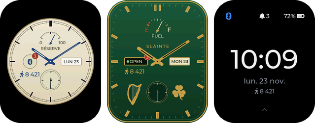
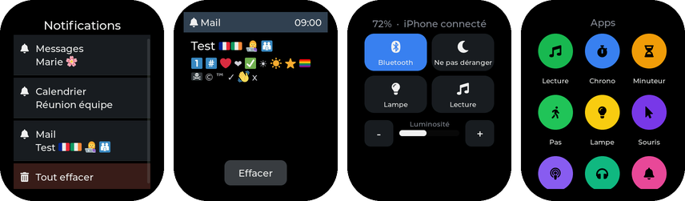
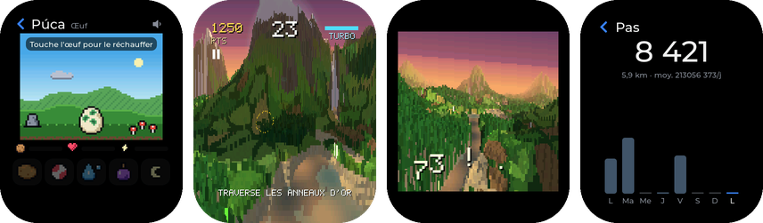

# twatch-ultra — firmware compagnon iPhone pour la LilyGo T-Watch Ultra

Français · **[English](README.md)**

Firmware écrit de zéro pour la **LilyGo T-Watch Ultra** (ESP32-S3, AMOLED 2,06" 410×502),
en **ESP-IDF 5.5** pur (sans Arduino), avec **LVGL 9** et **NimBLE**. La montre devient un
compagnon d'iPhone discret et endurant : notifications, appels, lecture en cours, heure
synchronisée, plus quelques apps et jeux.

C'est le portage de [twatch-idf](https://github.com/armSeb/twatch-idf) (T-Watch 2020 V1) sur
le matériel de l'Ultra. Les apps qui dépendaient d'un matériel absent de l'Ultra
(infrarouge, capture I/Q brute de l'ESP32 classique) n'ont pas été reprises.

Priorités, dans l'ordre : **stabilité**, **autonomie**, **finition**.





*(rendus PC de l'interface réelle avec des données factices, découpés selon les coins
arrondis de la dalle)*

> Projet indépendant, sans lien avec Apple Inc. ni LilyGo (Shenzhen Xinyuan Electronic
> Technology), qui ne l'approuvent ni ne le parrainent. Voir
> [Marques et avertissement](#marques-et-avertissement).

---

## Fonctionnalités

- **Notifications iPhone** (Apple Notification Center Service, aucune app à installer sur le
  téléphone) : liste triée, détail, actions iOS (*Effacer*, *Répondre*, *Accepter*/*Refuser*
  un appel), suppression synchronisée dans les deux sens, vibreur (pilote haptique DRV2605).
- **UTF-8 complet, émojis en couleur compris** : latin, vietnamien, cyrillique, grec,
  symboles, et 1 949 émojis en couleur ([Twemoji](https://github.com/jdecked/twemoji)) avec
  drapeaux, keycaps et séquences ZWJ (👩‍💻, 👨‍👩‍👧, 🏳️‍🌈…), dans les notifications, le bandeau,
  les appels et la lecture en cours.
- Écran d'**appel entrant**.
- **Lecture en cours** (Apple Media Service) : titre, artiste, album, progression, volume,
  lecture/pause, précédent/suivant, avec n'importe quelle app audio iOS.
- **Heure et fuseau** (heure d'été comprise) depuis l'iPhone (Current Time Service) ; la RTC
  PCF85063 garde l'heure UTC.
- **Trois cadrans** : *Rétro* (cadran ivoire, aiguilles bleuies, batterie en réserve de
  marche, guichet de date, petite seconde), *Pub* (plein écran, qui épouse le bord arrondi de
  la dalle, vert bouteille et laiton, harpe, jauge FUEL, enseigne OPEN/CLOSED pour la liaison
  avec le téléphone) et *Numérique*. Fond noir partout ailleurs : sur un AMOLED, un pixel noir
  ne consomme rien.
- **Apps** : *Chrono* (tours), *Minuteur* (sonne et vibre même écran éteint, puis se
  rouvre), *Lampe*, *Pas*, **Analyseur Wi-Fi**, **WebRX** (écoute de vos récepteurs
  OpenWebRX / OpenWebRX+ par Wi-Fi sur le haut-parleur — [guide](docs/fr/webrx.md)),
  **Radio** (webradios : MP3, AAC/HE-AAC, listes de lecture, titres —
  [guide](docs/fr/radio.md)), **Tone** (tonalité d'accès aux relais), **Souris** (pavé
  tactile, télécommande de présentation et multimédia en Bluetooth —
  [guide](docs/fr/mouse.md)). Une app ouverte reste en place : l'écran s'éteint dessus et s'y
  rallume. Un petit cadre permet d'en ajouter une en un seul fichier.
- **Púca**, animal virtuel en pixel art tiré du folklore irlandais —
  [guide](docs/fr/puca.md).
- **Démo « Tír na nÓg »**, une intro façon démoscène de 2 minutes calculée sur la montre —
  [guide](docs/fr/demo.md).
- **Envol**, un jeu de vol plein écran au-dessus d'un paysage irlandais inventé : on penche le
  poignet pour traverser des anneaux d'or — [guide](docs/fr/flight.md).
- **Lever le poignet** et **compteur de pas**, exécutés dans le capteur intelligent BHI260AP
  (firmware Bosch chargé au démarrage) : l'ESP32 ne fait rien pendant que vous marchez. Les
  deux désactivés, le rail du capteur est coupé.
- **Les notifications ne vous sortent jamais d'une app ou d'un menu** : elles arrivent en
  bandeau par-dessus.
- **Réglages rapides** : Bluetooth, **Ne pas déranger**, lampe, lecture en cours, luminosité.
- **Interface en français ou en anglais**, changée instantanément sans redémarrage.
- **Mises à jour par Wi-Fi** depuis l'iPhone (la montre devient point d'accès), deux slots
  de firmware avec retour automatique, et **retour à la version précédente** depuis la
  montre.
- Appairage sécurisé (LE Secure Connections + code à 6 chiffres), reconnexion automatique.
- **Écran Énergie** : jauge de l'AXP2101, consommation moyenne estimée, décharge précédente,
  part du temps écran allumé.
- Tous les périphériques que le firmware n'utilise pas (GNSS, NFC, LoRa, carte SD, ampli du
  haut-parleur) ont leur rail d'alimentation coupé.

**En cours** : LoRa (SX1262) avec MeshCore, historique sur la carte SD.

---

## Gestes

| Où | Geste / bouton | Action |
|---|---|---|
| Cadran | glisser ↑ | Notifications (fermer : ↓ ou →) |
| Cadran | glisser ↓ | Réglages rapides (fermer : ↑ ou →) |
| Cadran | glisser ← | Apps et réglages |
| Cadran | appui long | Choisir le cadran |
| Ailleurs | glisser → ou « ‹ » | Retour d'où l'on vient |
| Écran éteint | double tape | Réveil |
| Écran éteint | lever / tourner le poignet | Réveil, si *Lever le poignet* est activé |
| Bouton, écran éteint | appui court | Réveil |
| Bouton, hors du cadran | appui court | Retour au cadran (dans WebRX ou Radio en écoute : écran éteint, l'écoute continue) |
| Bouton, sur le cadran | appui court | Écran éteint |

**Ne pas déranger** : les notifications ne vibrent pas, n'allument pas l'écran et attendent
dans la liste ; les appels sonnent toujours. Une lune s'affiche sur le cadran.

---

## Prise en main

### 1. Flasher une fois par USB

Téléchargez `twatch-ultra-full.bin` depuis la page [Releases](../../releases), puis :

```bash
esptool.py --chip esp32s3 -b 921600 write_flash 0x0 twatch-ultra-full.bin
```

Cela efface tout (appairages compris). Les mises à jour suivantes passent par le Wi-Fi.

### 2. Appairer l'iPhone

1. Montre : glisser ← → *Réglages* → *Bluetooth* → **Appairer un iPhone**.
2. iPhone : *Réglages › Bluetooth* → **T-Watch**.
3. Saisir sur l'iPhone le **code à 6 chiffres affiché par la montre**.
4. Accepter *Autoriser les notifications*.

### 3. Mettre à jour par Wi-Fi (sans câble)

1. Montre : *Réglages › Mise à jour › Démarrer*. Le Bluetooth se coupe ; la montre crée le
   réseau Wi-Fi **T-Watch-OTA** et affiche son mot de passe.
2. iPhone ou ordinateur : rejoindre ce réseau, ouvrir **http://192.168.4.1**, choisir
   `twatch-ultra-app.bin`, *Envoyer*.
3. La montre vérifie l'image (nom du projet, SHA-256), l'active et redémarre.

L'image est écrite dans l'autre slot (`ota_0`/`ota_1`, 5 Mo chacun) : le firmware en cours
reste intact jusqu'au bout. Une nouvelle image est « à l'essai » au premier démarrage : si
elle plante dans les 30 s, le bootloader revient à la précédente. *Réglages › Mise à jour ›
Revenir à x.y.z* relance la version précédente sur demande.

Plus de détails : [compilation, flashage et tests](docs/fr/building.md).

---

## Documentation

| | Français | English |
|---|---|---|
| Compilation, flashage, tests | [docs/fr/building.md](docs/fr/building.md) | [docs/en/building.md](docs/en/building.md) |
| Architecture, énergie | [docs/fr/architecture.md](docs/fr/architecture.md) | [docs/en/architecture.md](docs/en/architecture.md) |
| Notes matérielles (broches, rails, écran) | [docs/fr/hardware.md](docs/fr/hardware.md) | [docs/en/hardware.md](docs/en/hardware.md) |
| WebRX (client OpenWebRX) | [docs/fr/webrx.md](docs/fr/webrx.md) | [docs/en/webrx.md](docs/en/webrx.md) |
| Radio (webradios) | [docs/fr/radio.md](docs/fr/radio.md) | [docs/en/radio.md](docs/en/radio.md) |
| Púca (animal virtuel) | [docs/fr/puca.md](docs/fr/puca.md) | [docs/en/puca.md](docs/en/puca.md) |
| Démo « Tír na nÓg » | [docs/fr/demo.md](docs/fr/demo.md) | [docs/en/demo.md](docs/en/demo.md) |
| Envol (jeu de vol) | [docs/fr/flight.md](docs/fr/flight.md) | [docs/en/flight.md](docs/en/flight.md) |
| Souris (pavé tactile Bluetooth) | [docs/fr/mouse.md](docs/fr/mouse.md) | [docs/en/mouse.md](docs/en/mouse.md) |
| Écrire une app, traduire | [docs/fr/apps-and-i18n.md](docs/fr/apps-and-i18n.md) | [docs/en/apps-and-i18n.md](docs/en/apps-and-i18n.md) |
| Changements | [CHANGELOG.md](CHANGELOG.md) | |
| Contribuer | [CONTRIBUTING.md](CONTRIBUTING.md) | |

---

## Licence

Code source du firmware : **MIT** (voir [LICENSE](LICENSE)).

Les images d'émojis de `assets/emoji.bin` viennent de Twemoji (© Twitter / X et
contributeurs), sous **CC BY 4.0**. Les décodeurs Helix MP3 et AAC de
[`components/helix_mp3/`](components/helix_mp3/) et
[`components/helix_aac/`](components/helix_aac/) restent sous **RPSL** / **RCSL** de
RealNetworks. Le pilote et le firmware Bosch du BHI260AP dans
[`components/bhy2/`](components/bhy2/) sont sous BSD-3-Clause.

Composants tiers et licences : [THIRD_PARTY_NOTICES.md](THIRD_PARTY_NOTICES.md).

## Remerciements

- [ESP-IDF](https://github.com/espressif/esp-idf) (Espressif), [Apache NimBLE](https://github.com/apache/mynewt-nimble),
  [LVGL](https://github.com/lvgl/lvgl) et [lv_font_conv](https://github.com/lvgl/lv_font_conv).
- Police [Montserrat](https://github.com/JulietaUla/Montserrat) de Julieta Ulanovsky,
  polices [DejaVu](https://dejavu-fonts.github.io/), icônes
  [Font Awesome Free](https://fontawesome.com), émojis
  [Twemoji](https://github.com/jdecked/twemoji).
- [LilyGoLib](https://github.com/Xinyuan-LilyGO/LilyGoLib), [SensorLib](https://github.com/lewisxhe/SensorLib)
  et [XPowersLib](https://github.com/lewisxhe/XPowersLib) (Lewis He, LilyGo) : brochage,
  registres et séquences d'initialisation pris comme référence.
- API Bosch Sensortec BHI2xy et firmware du BHI260AP.
- Décodeurs Helix MP3 et AAC en virgule fixe (RealNetworks, projet Helix DNA), tels
  qu'empaquetés par [ESP8266Audio](https://github.com/earlephilhower/ESP8266Audio)
  (Earle F. Philhower III).
- Spécifications publiques *ANCS*, *AMS* et *Accessory Design Guidelines* d'Apple.

## Marques et avertissement

iPhone, iOS et Apple Watch sont des marques d'Apple Inc. T-Watch et LilyGo sont des marques
de leurs propriétaires respectifs. Elles ne sont citées que pour décrire la compatibilité et
l'origine ; ce projet est indépendant, sans lien avec elles, ni approuvé ni parrainé. Ce
n'est pas un accessoire MFi (« Made for iPhone »).

Le logiciel est fourni « tel quel », sans garantie (voir [LICENSE](LICENSE)). Flasher un
firmware et manipuler des batteries lithium se fait à vos risques.
