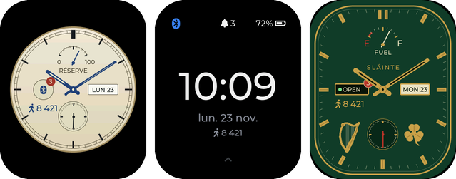
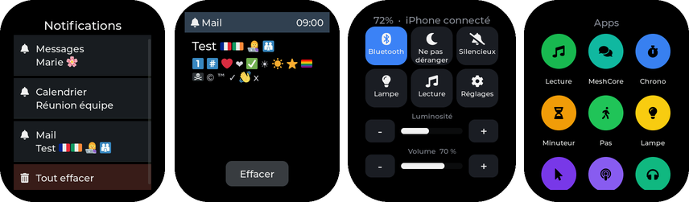
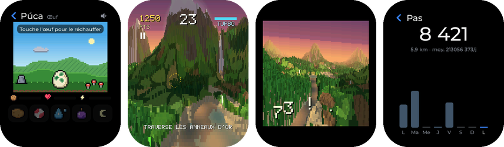

# twatch-ultra — iPhone companion firmware for the LilyGo T-Watch Ultra

**[Français](README.fr.md)** · English

A from-scratch firmware for the **LilyGo T-Watch Ultra** (ESP32-S3, 2.06" AMOLED 410×502)
written in pure **ESP-IDF 5.5** (no Arduino), with **LVGL 9** and **NimBLE**. It turns the
watch into a quiet, long-lasting iPhone companion: notifications, calls, now playing, time
sync, plus a few apps and games.

It is the port of [twatch-idf](https://github.com/armSeb/twatch-idf) (T-Watch 2020 V1) to
the Ultra's hardware. The apps that needed hardware the Ultra does not have (infrared, the
classic ESP32's raw I/Q capture) were left out.

Priorities, in order: **stability**, **battery life**, **finish**.





*(PC renders of the real UI with sample data, French UI, cut to the panel's rounded
corners)*

> Not affiliated with, endorsed by or sponsored by Apple Inc. or LilyGo (Shenzhen Xinyuan
> Electronic Technology). See [Trademarks and disclaimer](#trademarks-and-disclaimer).

---

## Features

- **iPhone notifications** (Apple Notification Center Service, no app to install on the
  phone): sorted list, detail view, iOS actions (*Clear*, *Reply*, *Accept*/*Decline* a call),
  removal synced both ways, vibration (DRV2605 haptic driver).
- **Full UTF-8, colour emoji included**: Latin, Vietnamese, Cyrillic, Greek, symbols, and
  1,949 colour emoji ([Twemoji](https://github.com/jdecked/twemoji)) with flags, keycaps and
  ZWJ sequences (👩‍💻, 👨‍👩‍👧, 🏳️‍🌈…), in notifications, the banner, calls and now playing.
- **Incoming call** screen.
- **Now playing** (Apple Media Service): title, artist, album, progress, volume, play/pause,
  previous/next — works with any iOS audio app.
- **Time and time zone** (DST included) from the iPhone (Current Time Service); the PCF85063
  RTC keeps UTC.
- **Three watch faces**: *Retro* (ivory dial, blued hands, battery as power reserve, date
  window, small seconds), *Pub* (full-screen, following the panel's rounded edge, bottle green
  and brass, harp, FUEL gauge, OPEN/CLOSED sign for the phone link) and *Digital*. Black
  backgrounds everywhere else: on AMOLED, black pixels draw nothing.
- **Apps**: *Stopwatch* (laps), *Timer* (beeps and vibrates even with the screen off, then
  reopens), *Torch*, *Steps*, **Wi-Fi analyzer**, **WebRX** (listen to your OpenWebRX /
  OpenWebRX+ receivers over Wi-Fi on the watch speaker — [guide](docs/en/webrx.md)),
  **Radio** (web radios: MP3, AAC/HE-AAC, playlists, song titles — [guide](docs/en/radio.md)),
  **Tone** (repeater access tone), **Mouse** (Bluetooth touchpad, clicker and media remote —
  [guide](docs/en/mouse.md)). An open app stays put: the screen turns off on it and wakes
  back to it. A small app framework lets you add one in a single file.
- **Púca**, a pixel-art virtual pet from Irish folklore — [guide](docs/en/puca.md).
- **Demo "Tír na nÓg"**, a 2-minute demoscene-style intro computed on the watch —
  [guide](docs/en/demo.md).
- **Soar**, a full-screen flying game over an invented Irish landscape: tilt your wrist to fly
  through gold rings — [guide](docs/en/flight.md).
- **Raise to wake** and **step counter**, both running inside the BHI260AP smart sensor
  (Bosch firmware loaded at boot): the ESP32 does nothing while you walk. With both off, the
  sensor's power rail is cut.
- **Notifications never pull you out of an app or menu**: they slide in as a banner on top.
- **Quick controls**: Bluetooth, **Do not disturb**, torch, now playing, brightness.
- **French or English UI**, switched instantly without a restart.
- **Over-the-air updates** from the iPhone over Wi-Fi (the watch becomes an access point),
  two firmware slots with automatic rollback, plus **going back to the previous version**
  from the watch.
- Secure pairing (LE Secure Connections + 6-digit passkey), automatic reconnection.
- **Energy screen**: battery gauge of the AXP2101, estimated average consumption, previous
  discharge, screen-on share.
- Every peripheral the firmware does not use (GNSS, NFC, LoRa, SD card, speaker amplifier)
  has its power rail switched off.

- **MeshCore** on the LoRa radio (SX1262), EU/UK Narrow preset by default. The official
  MeshCore app pairs over Bluetooth as a companion and sets the radio; messages read on the
  watch are still delivered to the app. Turn it on in Settings › Bluetooth › MeshCore.

**In progress**: MeshCore message alerts, history on the SD card, low-power LoRa receive.

---

## Gestures

| Where | Gesture / button | Action |
|---|---|---|
| Watch face | swipe ↑ | Notifications (close: ↓ or →) |
| Watch face | swipe ↓ | Quick controls (close: ↑ or →) |
| Watch face | swipe ← | Apps and settings |
| Watch face | long press | Choose the watch face |
| Anywhere else | swipe → or « ‹ » | Back to where you came from |
| Screen off | double tap | Wake up |
| Screen off | raise / turn the wrist | Wake up, if *Raise to wake* is on |
| Button, screen off | short press | Wake up |
| Button, not on the face | short press | Back to the watch face (in WebRX or Radio while listening: screen off, listening continues) |
| Button, on the face | short press | Screen off |

**Do not disturb**: notifications neither vibrate nor wake the screen and wait in the list;
calls still ring. A moon shows on the watch face.

---

## Getting started

### 1. Flash it once over USB

Download `twatch-ultra-full.bin` from the [Releases](../../releases) page, then:

```bash
esptool.py --chip esp32s3 -b 921600 write_flash 0x0 twatch-ultra-full.bin
```

This erases everything (including pairings). Later updates go over Wi-Fi.

### 2. Pair the iPhone

1. Watch: swipe ← → *Settings* → *Bluetooth* → **Pair an iPhone**.
2. iPhone: *Settings › Bluetooth* → **T-Watch-Ultra**.
3. Type the **6-digit code shown on the watch** on the iPhone.
4. Accept *Allow notifications*.

### 3. Update over Wi-Fi (no cable)

1. Watch: *Settings › Update › Start*. Bluetooth turns off; the watch creates the Wi-Fi
   network **twatch-ultra-OTA** and shows its password.
2. iPhone or computer: join that network, open **http://192.168.4.1**, choose
   `twatch-ultra-app.bin`, *Send*.
3. The watch checks the image (project name, SHA-256), activates it and restarts.

The image is written to the other slot (`ota_0`/`ota_1`, 5 MB each): the running firmware
stays intact until the end. A new image is "on trial" at first boot: if it crashes within
30 s, the bootloader goes back to the previous one. *Settings › Update › Go back to x.y.z*
boots the previous firmware on request.

More: [building, flashing and tests](docs/en/building.md).

---

## Documentation

| | English | Français |
|---|---|---|
| Building, flashing, tests | [docs/en/building.md](docs/en/building.md) | [docs/fr/building.md](docs/fr/building.md) |
| Architecture, power | [docs/en/architecture.md](docs/en/architecture.md) | [docs/fr/architecture.md](docs/fr/architecture.md) |
| Hardware notes (pins, power rails, display) | [docs/en/hardware.md](docs/en/hardware.md) | [docs/fr/hardware.md](docs/fr/hardware.md) |
| WebRX (OpenWebRX client) | [docs/en/webrx.md](docs/en/webrx.md) | [docs/fr/webrx.md](docs/fr/webrx.md) |
| Radio (web radios) | [docs/en/radio.md](docs/en/radio.md) | [docs/fr/radio.md](docs/fr/radio.md) |
| Púca (virtual pet) | [docs/en/puca.md](docs/en/puca.md) | [docs/fr/puca.md](docs/fr/puca.md) |
| Demo "Tír na nÓg" | [docs/en/demo.md](docs/en/demo.md) | [docs/fr/demo.md](docs/fr/demo.md) |
| Soar (flying game) | [docs/en/flight.md](docs/en/flight.md) | [docs/fr/flight.md](docs/fr/flight.md) |
| Mouse (Bluetooth touchpad) | [docs/en/mouse.md](docs/en/mouse.md) | [docs/fr/mouse.md](docs/fr/mouse.md) |
| Writing apps, translating | [docs/en/apps-and-i18n.md](docs/en/apps-and-i18n.md) | [docs/fr/apps-and-i18n.md](docs/fr/apps-and-i18n.md) |
| Changes | [CHANGELOG.md](CHANGELOG.md) | |
| Contributing | [CONTRIBUTING.md](CONTRIBUTING.md) | |

---

## License

Firmware source code: **MIT** (see [LICENSE](LICENSE)).

The emoji images in `assets/emoji.bin` come from Twemoji (© Twitter / X and contributors),
under **CC BY 4.0**. The Helix MP3 and AAC decoders in
[`components/helix_mp3/`](components/helix_mp3/) and
[`components/helix_aac/`](components/helix_aac/) stay under the RealNetworks **RPSL** /
**RCSL**. The Bosch BHI260AP driver and firmware in [`components/bhy2/`](components/bhy2/)
are BSD-3-Clause.

Third-party components and their licenses: [THIRD_PARTY_NOTICES.md](THIRD_PARTY_NOTICES.md).

## Credits

- [ESP-IDF](https://github.com/espressif/esp-idf) (Espressif), [Apache NimBLE](https://github.com/apache/mynewt-nimble),
  [LVGL](https://github.com/lvgl/lvgl) and [lv_font_conv](https://github.com/lvgl/lv_font_conv).
- [Montserrat](https://github.com/JulietaUla/Montserrat) font by Julieta Ulanovsky,
  [DejaVu](https://dejavu-fonts.github.io/) fonts, [Font Awesome Free](https://fontawesome.com)
  icons, [Twemoji](https://github.com/jdecked/twemoji) emoji.
- [LilyGoLib](https://github.com/Xinyuan-LilyGO/LilyGoLib), [SensorLib](https://github.com/lewisxhe/SensorLib)
  and [XPowersLib](https://github.com/lewisxhe/XPowersLib) (Lewis He, LilyGo): pinout,
  register maps and initialisation sequences used as reference.
- Bosch Sensortec BHI2xy Sensor API and BHI260AP firmware.
- Helix MP3 and AAC fixed-point decoders (RealNetworks, Helix DNA project), as packaged by
  [ESP8266Audio](https://github.com/earlephilhower/ESP8266Audio) (Earle F. Philhower III).
- Apple's public *ANCS*, *AMS* and *Accessory Design Guidelines* specifications.

## Trademarks and disclaimer

iPhone, iOS and Apple Watch are trademarks of Apple Inc. T-Watch and LilyGo are trademarks of
their respective owners. They are used here only to describe compatibility and origin; this
project is independent and is not affiliated with, endorsed or sponsored by any of them. It
is not an MFi ("Made for iPhone") accessory.

The software is provided "as is", without warranty (see [LICENSE](LICENSE)). Flashing
firmware and handling lithium batteries is at your own risk.
