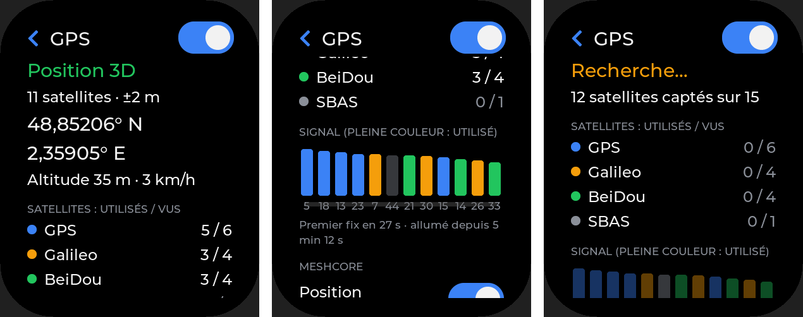

# GPS — position, satellites, MeshCore adverts

[Français](../fr/gps.md) · **English**

The **GPS** app turns the watch's GNSS receiver (u-blox MIA-M10Q: GPS, Galileo, BeiDou, QZSS
and SBAS) on or off and shows what it sees: fix state, position, altitude, speed, satellites
used and in view per constellation, and the signal of the 12 strongest ones. It also sets the
position given in **MeshCore adverts**.

## Use

| Where | Action |
|---|---|
| Switch at the top right | turns the GPS on / off (remembered, it stays on when the app is closed) |
| *3D fix* / *Searching…* | fix state; below, satellites used and accuracy (≈ 2.5 m × HDOP) |
| *Satellites: used / in view* | one line per constellation present |
| *Signal* | the 12 strongest satellites (dB-Hz); constellation colour, faded when not used; number below |
| *MeshCore › Position* | position in the watch's adverts (see below) |

The first fix takes 30 s to a few minutes under open sky (much longer indoors than near a
window). When off, the module keeps the almanac and time (permanent backup supply): turned on
again within hours, it gets a fix in seconds.

With a fix, the watch sets its clock from the GPS (when off by more than 2 s, at most every
6 h), even without an iPhone.

## Power

- **Off** (default): module supply cut, pins high-impedance, no task. Nothing draws.
- **On, app closed**: the module keeps tracking; the ESP32 keeps its light sleep and only reads
  for **2 s every 30 s**. Count the module's draw (≈ 25 to 35 mA while searching, a bit less
  afterwards) on top of the watch's.
- **App open**: continuous reading, the screen refreshes every second.

## MeshCore

- **Position in adverts** is the *share location* setting of the iPhone MeshCore app (the same
  one, on both sides). On: each advert of the watch carries the last fix (under 2 minutes old);
  with the GPS off or no fix, the last known position. Off: adverts carry no position.
- MeshCore also stores the GPS position (first fix, then every 200 m, at most one write per
  quarter hour), used after a reboot.
- **iPhone MeshCore app**: the custom variable `gps` (device settings) turns the same GPS on and
  off. Location telemetry goes to allowed contacts (app's *location telemetry* setting).

## Technical details

UART1 at 38,400 baud (TX 43, RX 44), NMEA 4.11 sentences: RMC, GGA, GSA, GSV (GLL and VTG
turned off at start with UBX-CFG-VALSET). The NMEA reader is tested on PC
(`host_tests/test_gnss.c`). Rail BLDO1 (3.3 V); VRTC powers the module's backup permanently.
