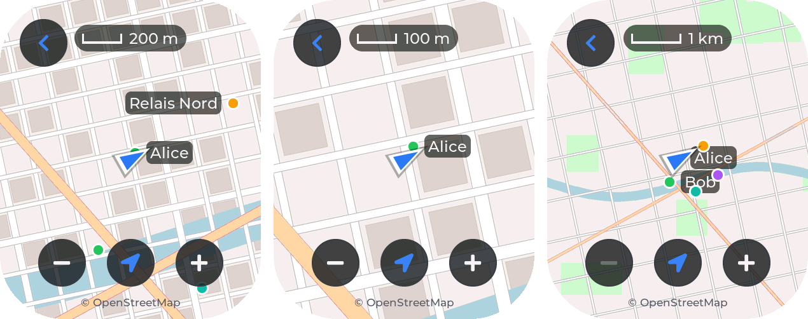

# Maps — OpenStreetMap tiles on the SD card

[Français](../fr/maps.md) · **English**

The **Maps** app shows OpenStreetMap maps stored on the micro-SD card, offline: your GPS
position (arrow pointing where you walk) and the MeshCore nodes that advertise theirs
(contacts, repeaters, rooms, sensors).



*PC simulator screenshots, with demo tiles (made-up data).*

## Use

| Where | Action |
|---|---|
| Drag | moves the map (with momentum); stops following your position |
| Pinch, or double tap | zoom in / out around the fingers |
| **−** / **+** | zoom out / in (greyed at the limit) |
| **➤** (bottom centre) | centres on you and follows your position (blue: following). Turns the GPS on if it is off |
| Tap a node | its name, distance and age of its advert |
| **‹** or the watch button | back (swiping right moves the map) |

- **Me**: blue arrow in the direction of travel (above 2.5 km/h), blue dot when still; grey
  when the position is old (no fix for 10 s). Pale disc: accuracy, when larger than the marker.
- **MeshCore nodes**: green chat, orange repeater, purple room, teal sensor. Names never
  overlap: a name without room is not drawn (tap the dot). The list is re-read every 15 s.
- **Scale** at the top centre.
- On first open the map centres on your position, else MeshCore's, else the middle of the
  tiles found. It then keeps its view until a reboot.
- You can zoom **two levels past** the most detailed one on the card: the tile is enlarged.
  A missing tile is replaced by an enlarged piece of a wider level (up to 4 levels), so an
  incomplete map stays readable.

## Preparing the SD card

Same layout as MCLite and the MeshCore T-Deck firmware: maps prepared for them work as is.

```
/tiles/<zoom>/<x>/<y>.png
```

- 256 × 256 "slippy map" tiles (512 × 512 accepted, halved); palette, grey, RGB or RGBA PNG,
  not interlaced.
- Zoom levels found on the card are detected automatically. For a city, 12 to 16 are enough
  (a few MB to a few tens); 17 and 18 for street detail, much bigger.
- Suggested tool: [map-tiles-downloader](https://github.com/tekk/map-tiles-downloader)
  (pick the area and levels, copy the `tiles` folder to the root of the card). Copy over USB
  (Settings › SD card › share with PC) or with a card reader.
- **Licence and use**: data © OpenStreetMap contributors (ODbL). The official
  `tile.openstreetmap.org` server **forbids bulk downloading**: use a tile provider that
  allows it, or render your own tiles.

Without an SD card, without a `tiles` folder, or while the card is shared with the PC, the
app says so on screen and reads the card again as soon as it is back.

## Power and memory

- While the app is open, the GPS (if on) is read continuously, as in the GPS app.
- Decoded tiles live in **PSRAM** (a cache of 12 to 20 tiles, ≈ 128 KB each, leaving 1.5 MB to
  the rest of the watch), freed when the app closes. Nothing in internal RAM.
- The SD card is held only while a file is read: MeshCore (same SPI bus) keeps receiving.

## Technical details

- `main/maptiles.c`: "tiles" task (PSRAM stack: the SD card is not flash), LRU cache,
  priority queue (screen centre first, then one ring ahead), zoom levels and centre of the
  covered area.
- `main/png_tile.c`: PNG → RGB565 decoder, inflated by the ESP32-S3 ROM `tinfl` (no zlib code
  added). Host-tested (`host_tests/test_png.c`: every format, truncated or corrupted files).
- `main/app_map.c`: a single LVGL object draws tiles, nodes, position and scale. While a tile
  loads, the neighbouring level already in cache is drawn scaled, so zooming shows no hole.
- Pinch: the touch controller (CST9217) tracks two fingers; `display_touch_second()` returns
  the second one.
