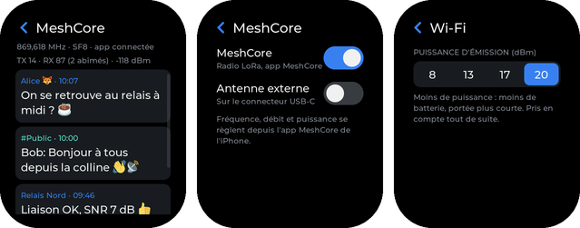
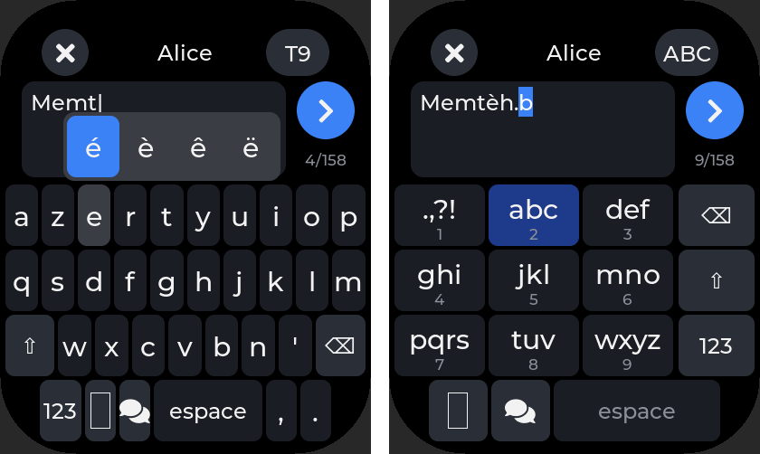
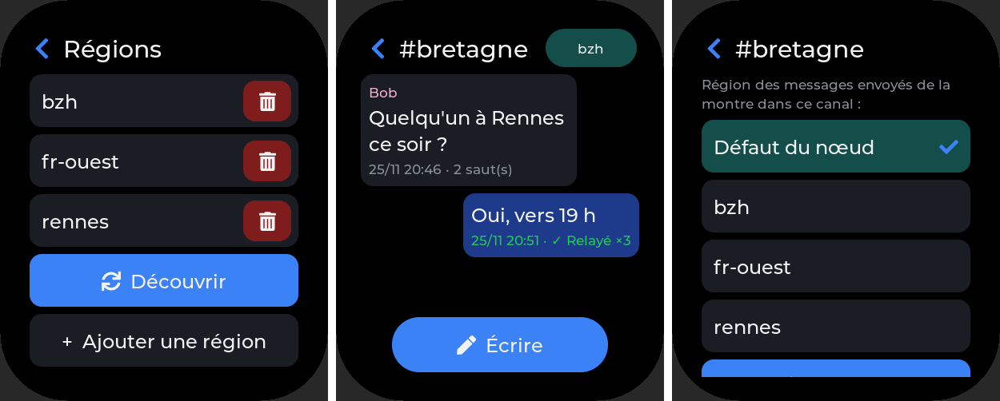

# MeshCore — LoRa messages from the watch

[Français](../fr/meshcore.md) · **English**

The watch is a **MeshCore companion node**: its SX1262 LoRa radio joins the
[MeshCore](https://meshcore.co.uk) mesh, and the official **MeshCore app** on the iPhone
connects to it over Bluetooth to read and send messages, manage contacts and channels, and
set the radio. The protocol is the upstream companion firmware (v1.18.0), so the app sees the
watch as an ordinary MeshCore device.



## Turning it on

1. Watch: *Settings › MeshCore*, switch **MeshCore** on. The LoRa radio starts and the watch
   advertises the MeshCore Bluetooth service next to its usual ones.
2. iPhone: the watch must already be paired (*Settings › Bluetooth › Pair an iPhone*, see the
   [README](../../README.md)). Open the MeshCore app and connect to **T-Watch-Ultra**. It is
   the same Bluetooth link as notifications: nothing else to pair.

The first start creates the node's identity (keys) and saves it on the watch. Contacts (up to
350), channels (up to 40) and the radio settings are stored in the `storage` partition and
survive restarts and updates.

## Radio settings

Default preset: **EU/UK Narrow**, 869.618 MHz, 62.5 kHz bandwidth, SF8, CR 4/8, 22 dBm. Every
radio parameter (frequency, bandwidth, spreading factor, coding rate, power) is set **from the
MeshCore app** and saved on the watch; the watch shows them but does not edit them.

**Antenna**: at the top of the **Radio** tab of the MeshCore app (*Built-in* / *External*),
or *Settings › MeshCore › External antenna*. External: antenna on the USB-C connector. It
applies immediately.

## The MeshCore app on the watch

The **MeshCore** app (first in the app list) has three tabs:

- **Contacts**: chat contacts and rooms, plus conversations whose contact was deleted since;
- **Channels**: the channels set up in the iPhone app;
- **Radio**: **Flood advert** (repeated across the network) and **Zero-hop advert** buttons,
  node name, frequency, SF and power, iPhone app state (connected, up to date, or
  number of messages waiting for it), radio counters (`TX` with failures, `RX` with damaged
  packets, noise floor) and SD card state.

Lists put conversations with **unread** messages first, then the **Public** channel (MeshCore's
channel with the well-known key), then follow **alphabetical** order
(leading emoji and punctuation ignored, case and accents ignored). Each row shows the last
message, its time and a badge with the unread count; tab titles count unread messages too.
Past 40 rows, *Show more* loads the rest.

For a contact, the row also shows its **path**, like the iPhone app: *direct*, *2 hop(s)*,
or *flood* when no path is known. **Search…**, at the top of the Contacts and Channels tabs,
opens the keyboard: the list keeps only names containing the typed text (case and accents
ignored). Tap the filter to clear it.

Touching a row **slides the conversation in**: bubbles, oldest at the top, sender name on
channels, messages sent from the iPhone on the right, an *Unread* marker. *Older messages*
goes further back (watch, then SD card). Back: the arrow, a swipe right or the button. Emoji
and any UTF-8 text display as on the phone.

### Writing from the watch

At the bottom of every conversation, **Write** opens the full-screen keyboard. It works with
any contact or channel, even without messages.



- **Full keyboard** (AZERTY or QWERTY, *Settings › MeshCore*): the key that counts is the one
  under the finger **on release**, shown large above it, so you can slide to correct.
  **Long press** on e, a, c, i, o, u, y, n, ' or .: accents (é è ê ë…), slide onto one and
  release. Automatic capital at the start of a sentence; ⇧ twice: caps lock. *123*: digits and
  symbols.
- **T9**: huge keys. Tapping the same key cycles through its letters (2: a b c 2 à â ç); the
  pending letter is highlighted and is kept after one second or with another key. Long press:
  the digit.
- The top-right button switches between them (**T9** / **ABC**); the last one used comes back
  next time.
- 🙂: common emoji. 💬: **quick replies** ("OK 👍", "On my way", "Where are you?"…).
- The counter shows bytes used (158 for a direct message; on a channel the node name takes
  part of it). The draft is kept if you close without sending.

**Delivery state**, under every message written on the watch, as in the iPhone app:

| | Direct | Channel |
|---|---|---|
| in progress | *Sending… 2/3* (attempt) | *Sent, waiting for repeats* |
| success | *✓ Delivered · 1.8 s* (recipient's ack, round trip) | *✓ Heard 3 repeat(s)* |
| failed | *✗ Failed* | *No repeat heard* |

For direct messages the watch **retries** until the recipient confirms, up to the *Attempts*
setting (3 by default, like the iPhone app); the last attempt floods if the direct path stays
silent. Retries go on **with the app closed and the screen off**. Touching a failed message
resends it.

The iPhone app does not see messages written on the watch: the companion protocol has no
frame for that. They stay in the watch history and on the SD card (with their state).

### Regions

A region (*scope*) limits a message's flood to the repeaters that know it. The node only
keeps its **default** region; the iPhone app's region list and per-channel choice stay in
the app. So the watch has its own:



- **Radio tab › Regions**: the list. **Add a region** opens the keyboard (no automatic
  capital; type the name without #, e.g. "bzh"). The bin removes it.
- **Discover** asks repeaters among the contacts that are reachable directly for their
  regions: known path (after an exchange with it), or the path of its last advert heard since
  the watch started. At most 12, one every 1.5 s. Names received join the list and are shown
  under the button. A repeater only answers direct requests and rate-limits them.
- In a **channel**, the button at the top right shows the region of its sends (*Region*:
  the node's default). Tap it to pick one, or add one.

A region's key is computed as on repeaters (SHA-256 of "#name"). Private regions ($) are not
handled. Direct messages keep the default region.

### Read and unread

- Opening a conversation on the watch marks it **read**.
- A message the iPhone app has **fetched**, or a conversation you just **wrote** in from the
  app, becomes read on the watch.
- **Reading a message on the watch does not take it away from the app**: it stays in its
  queue (up to 256 messages) and is delivered when the app connects. The MeshCore protocol
  cannot tell the app a message was read, so it shows as new there.

### History and SD card

The watch keeps the **last 128 messages** (received, and sent from the app) with their read
state, in memory and on flash: they survive a restart. With a **micro-SD card**, every message
is also archived on it, one file per conversation in `/meshcore`, and older messages are read
back from the card.

The archive files (`c-<key>.jsonl` for a contact, `g-<key>.jsonl` for a channel) are JSON
Lines, readable on a computer: one line per message, padded with spaces to 512 bytes so the
watch can jump straight to older ones. For example:

```json
{"seq":42,"ts":1764000000,"time":"2026-11-24 17:00","dir":"in","conv":"#fr","sender":"Bob","text":"Hi","snr":-5.25,"hops":3}
```

`ts` is the sender's timestamp (UTC), `time` the same in local time, `dir` `in` (received) or
`out` (sent from the app), `sender` the author on a channel, `hops` 0 for a direct message.
With `jq`: `jq -r '.time + " " + .sender + " " + .text' g-*.jsonl`. The old `.bin` files (0.2.15
to 0.2.19) are no longer read.

The card is detected when inserted (within about 3 s, 15 s with the screen off), mounted at
once and unmounted if pulled out. *Settings › SD card* shows the free space and offers **Eject card** (buffers written,
then unmounted: it can be removed) and **Mount card again**. It must be formatted as FAT32.
The watch log is also written to it, in `/logs/YYYY-MM-DD.log`. To spare the card and the
battery, the log and the archive stay in memory and are only written every 10 minutes (sooner
if the log fills up), and before a restart, an eject or sharing.

**Share with the computer** shows up when the watch is plugged into a computer: the card
appears there as a USB drive, readable and writable (about 1 MB/s, the bus is shared with the
radio). While shared, the watch stops writing to the card (logs and messages wait in memory,
MeshCore keeps receiving) and the USB serial console is off. **Ejecting the drive on the
computer** gives the card back to the watch, which mounts it again; so do *Stop sharing*,
unplugging the cable or pulling the card, but without an eject on the computer its last writes
may be lost.

When MeshCore is off, the app offers a button to turn it on.

During a Wi-Fi update, MeshCore keeps receiving (Bluetooth is off, so the iPhone app cannot
connect meanwhile); the queue and the history are saved before the watch restarts.

## Power

With MeshCore on, the radio listens all the time: battery life drops noticeably. Turn it off
in *Settings › MeshCore* when you do not need it; the radio's power rail is then cut.

The SX1262 shares its SPI bus with the SD card and the NFC chip: while the radio runs, their
rails stay on with their chip select held high, otherwise the unpowered chips pull the bus
down and the radio does not answer (details in [hardware notes](hardware.md)).

## Troubleshooting

| What you see | Meaning |
|---|---|
| *LoRa radio stopped: ESP_ERR_NOT_FOUND* | The SX1262 does not answer on the SPI bus. Turn MeshCore off and on; the serial log (`sx1262:` lines) gives the chip status. |
| `TX` grows but nobody hears you | Check the antenna setting, and that the preset matches your local mesh. |
| `RX` stays at 0 | Same; a noise floor around −120 dBm is normal, much higher means local interference. |
| The app does not see the watch | MeshCore must be on, and the watch paired with this iPhone. |

## Not yet

Message alerts (banner and vibration), predictive T9 input, low-power receive.
