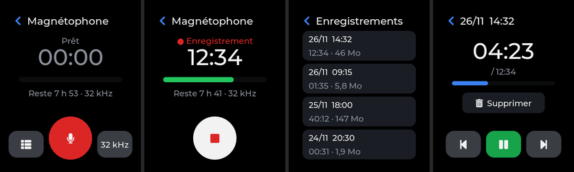

# Recorder — record with the microphone

[Français](../fr/recorder.md) · **English**

The **Recorder** app (*Magnéto* in French) records the watch microphone to the **micro-SD
card**, even with the **screen off**, and plays recordings back on the speaker.

## Format

- **WAV**, 16-bit mono PCM: plays everywhere (computer, phone, editors), lossless, and costs
  the watch no computation (the CPU stays at its lowest clock, easier on the battery than MP3
  encoding).
- **32 kHz** by default (high quality, up to 16 kHz bandwidth): about 230 MB per hour.
- **16 kHz** option (voice): about 115 MB per hour, twice the duration.
- Files go to the card's **REC** folder, named after the start date and time:
  `REC/20261126-143205.WAV`.
- Automatic gain (up to +36 dB, instant decrease on loud sounds, slow recovery) and an 80 Hz
  high-pass filter against wind rumble and knocks.

## Use

| Where | Action |
|---|---|
| Big red button (microphone) | **start** recording |
| Big white ■ button | **stop**: the file is closed cleanly on the card |
| *32 kHz* / *16 kHz* | change quality (remembered) |
| ≡ | list of **recordings**, newest first |
| A list row | opens the player and starts playback |
| ◀◀ / ▶▶ (player) | back / forward 10 s |
| ▶ / ❚❚ (player) | play / pause |
| *Delete* (player) | tap twice (*Confirm*) to erase the file |
| Side button | screen off, **recording continues**; press again to come back |
| Swipe → or ‹ | leave the app: **recording continues**; reopen the app to see or stop it |

- The green bar shows the level; *7 h 40 left* is what the card can still hold at the chosen
  quality.
- Beeps and notifications still sound during a recording (and will be heard in the file).
- To get the files: **USB sharing** of the card (cable plugged in, Settings → SD card) or the
  watch **web server**, *Files* tab, `REC` folder.

## Reliability

- Samples go through an 8 s PSRAM buffer, then are written in 64 KB sector-aligned blocks: few
  writes, and a slow card does not lose audio.
- The WAV header is refreshed and the file committed every **30 s**: after a crash, a flat
  battery or a removed card, only the last seconds are lost. Playback on the watch trusts the
  real file size.
- Card full: recording stops and is kept (2 MB are left free). Maximum file size: 3.75 GB
  (about 16 h at 32 kHz).

## Power

While recording, light sleep is suspended (the microphone clock must run) but the CPU stays at
its lowest frequency; the SD card stays powered. Otherwise the microphone and its clock are off.

## Technical notes

PDM MEMS microphone (clock GPIO 17, data GPIO 18) on **I2S0**, the only ESP32-S3 port with the
PDM-to-PCM filter; the speaker moved to I2S1. PDM clock about 2 MHz (32 kHz × 64 or
16 kHz × 128). Code: `main/recorder.c` (engine), `main/app_rec.c` (screen).
