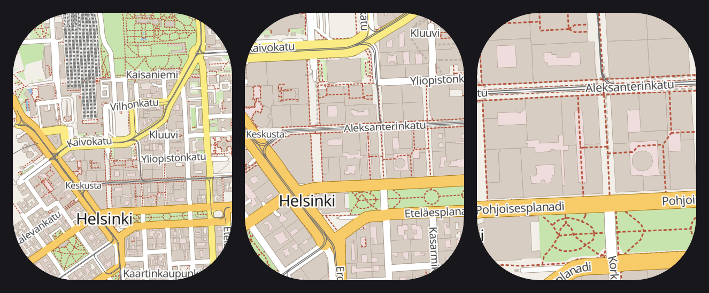

# Offline maps — making the tiles

[Français](../fr/tiles.md) · **English**

The **Maps** app reads maps from a single **`tiles.pmtiles`** file at the micro-SD root
([PMTiles](https://github.com/protomaps/PMTiles), 256 × 256 PNG tiles): one big file copies
fast, where tens of thousands of small tiles take hours on an SD card.
`tools/tuiles/generer-tuiles.sh` builds it on a Linux PC from an OpenStreetMap extract from
[Geofabrik](https://download.geofabrik.de), with a style made for the watch screen: large
labels, wide high-contrast roads, little clutter. One command; only Docker is needed.



*Preview from a small test extract (Helsinki), at the screen's size.*

## Requirements

- **Linux** with **Docker** (`sudo apt install docker.io`, `sudo usermod -aG docker $USER`, log in again).
- Whole **France**: about **12 GB** of free disk and **8 GB RAM**. A region needs ten times less.

## Usage

```sh
# France up to level 12, plus 25 km around Rennes in detail (levels 13 to 16)
tools/tuiles/generer-tuiles.sh --detail 48.11,-1.68,25

# Same, and copy to the mounted SD card
tools/tuiles/generer-tuiles.sh --detail 48.11,-1.68,25 --sd /media/$USER/WATCH

# Only count tiles and SD space
tools/tuiles/generer-tuiles.sh --detail 48.11,-1.68,25 --estimer

# Another extract (Geofabrik URL path), detailed everywhere up to level 14
tools/tuiles/generer-tuiles.sh --region europe/belgium --zooms 0-14
```

Steps: download the extract (only when newer, MD5-checked, cached in `~/.cache/twatch-tuiles`);
**estimate** tiles and SD space, stopping if it doesn't fit (`--forcer` overrides); build
vector tiles once with [Planetiler](https://github.com/onthegomap/planetiler) (OpenMapTiles
schema, 30 min to over an hour for France depending on cores); **draw** 256 × 256 palette PNGs into `./tuiles-montre/tiles`
(MapLibre Native), then pack them into `./tuiles-montre/tiles.pmtiles` (identical tiles stored
once); with `--sd`, copy that file to the card and `sync`. Run the same command again to resume after an
interruption; `--refaire` redraws everything. `--help` lists every option.

## Sizing for a 2 GB card

Each level has four times as many tiles as the previous one. Whole France levels 0–12:
37,000 tiles, ≈ 320 MB at most; level 13 alone adds 110,000 tiles (≈ 950 MB). A 25 km detail
zone at levels 13–16: 20,500 tiles, ≈ 140 MB. Sea and empty areas take almost nothing.

**Suggested**: France 0–12 plus 25 km around home at 13–16, under 500 MB. With a single file
the card's cluster size no longer matters (FAT16 limits a file to 2 GB).

## Style

`tools/tuiles/style-montre.json` (MapLibre, OpenMapTiles schema) is generated by
`tools/tuiles/style_montre.py`: edit colours, sizes and levels there, regenerate, run the tile
script again (only drawing is redone). `--style` tries another style.

## Licences

Map data © OpenStreetMap contributors ([ODbL](https://www.openstreetmap.org/copyright)),
OpenMapTiles schema (CC-BY 4.0), Noto Sans (OFL). Planetiler (Apache 2.0), TileServer GL and
MapLibre Native (BSD) are pulled by Docker, not copied into this repository.
