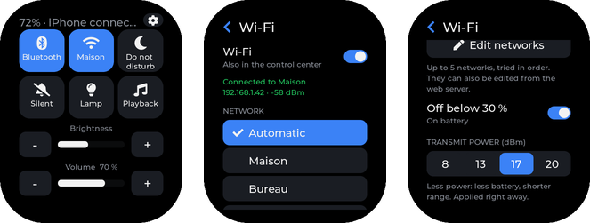
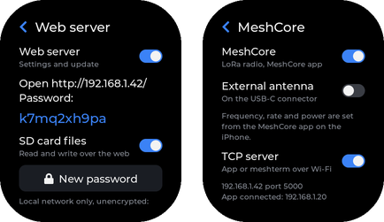
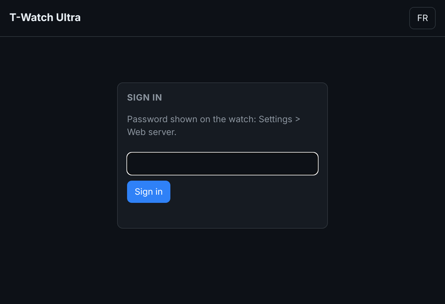
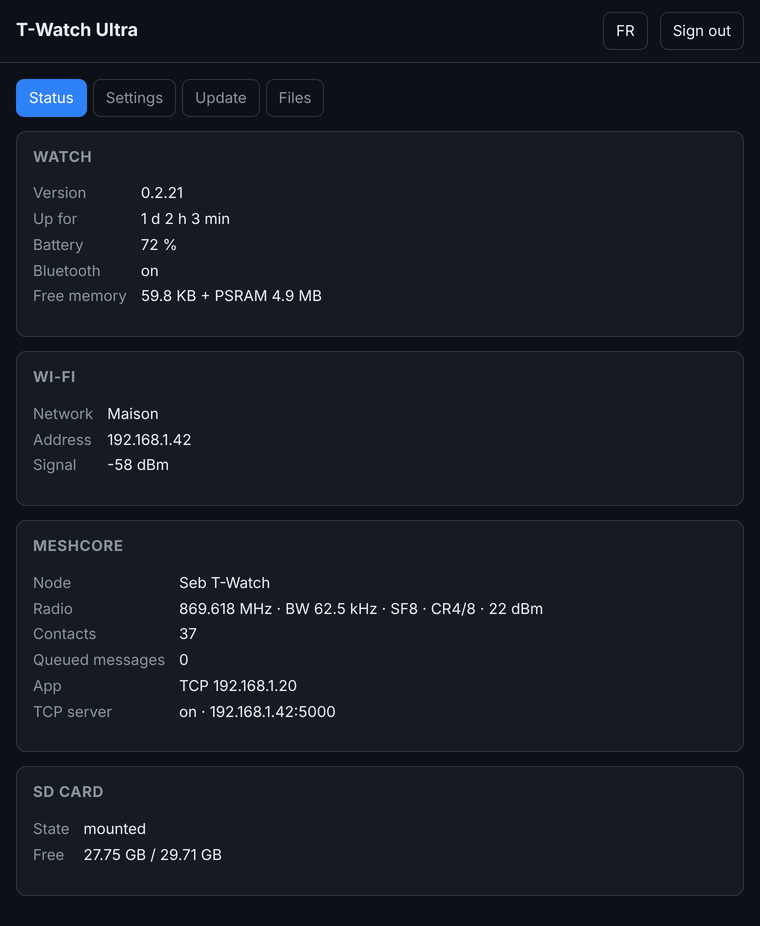
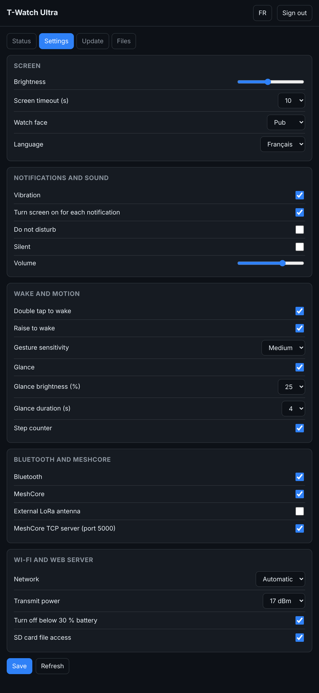
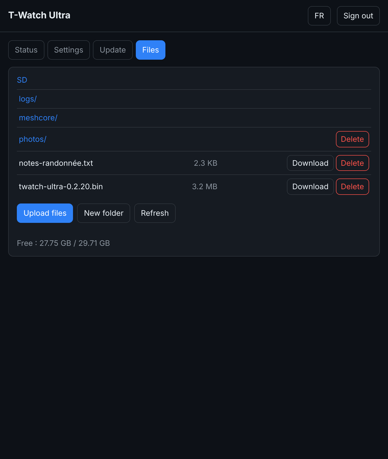

# Wi-Fi, web server and MeshCore over TCP

[Français](../fr/wifi.md) · **English**

Since 0.2.21 the watch's Wi-Fi is managed in one place. Turn it on from the control center or
the settings; apps that need it (WebRX, Radio, Wi-Fi analyzer) use the existing connection, or
turn it on while they run. Two network services can run while Wi-Fi is on: a **web server**
(settings, update, SD card files) and a **MeshCore TCP server** for the MeshCore app or
meshterm. Everything is **off by default**.

## Turning Wi-Fi on

- **Control center** (swipe down from the watch face): a short tap on the **Wi-Fi** tile turns
  it on or off. When on, it shows the network name. A **long press** opens the Wi-Fi settings.
  The watch settings now sit under the small gear, top right.
- **Settings › Wi-Fi**: switch, connection state (network, IP address, signal), network
  choice, transmit power and low-battery cut.

The chosen state is kept across restarts.

### Networks

The watch keeps up to **5 networks**. In *Automatic* mode it scans and tries the known
networks in list order. You can also force a single one (*Settings › Wi-Fi › Network*).

To add, edit or reorder networks:

- **from the web server** (*Update › Wi-Fi networks, WebRX and radios* tab), without
  turning Bluetooth off;
- or **from the watch**: *Settings › Wi-Fi › Edit networks*, then *Start*. The watch turns
  Bluetooth off and creates its own access point, as for an update; it restarts after saving.

On failure the watch retries by itself after 5 s, 10 s, 30 s, 1 min, 2 min, then every 5 min.
During long waits the Wi-Fi radio is off to save battery. **Retry** tries again right away.

### Battery and Bluetooth

- **Off below 30 %** (on by default): on battery, Wi-Fi turns off when the charge drops below
  30 %, with a message on screen. You can turn it back on afterwards. Booting below 30 % leaves
  it off.
- **Bluetooth**: both radios coexist. The iPhone (notifications, MeshCore app) stays connected
  while Wi-Fi runs. The Wi-Fi modem sleeps between beacons, except during a stream (WebRX,
  Radio, MeshCore TCP client, web transfer).
- If internal RAM runs short next to Bluetooth, the global switch says so (*Not enough
  memory*) and never turns Bluetooth off. Only WebRX, Radio and the analyzer may pause it
  while they play, as before.

## Web server

*Settings › Web server*:

1. Turn **Web server** on (Wi-Fi turns on if it was off).
2. On a computer or phone **on the same network**, open the address shown, e.g.
   `http://192.168.1.42/`.
3. Enter the **password** shown on the watch (10 letters and digits, picked at random the
   first time). **New password** picks another one and signs every browser out.

The page has four tabs, in French or English:

| Tab | Content |
|---|---|
| **Status** | Version, battery, Wi-Fi, MeshCore (node, radio, contacts, connected app), SD card, memory |
| **Settings** | Screen, notifications and sound, wake and motion, Bluetooth and MeshCore, Wi-Fi |
| **Update** | Upload of `twatch-ultra-x.y.z.bin`, link to Wi-Fi networks, WebRX and radios |
| **Files** | SD card: browse, download, upload, new folder, delete |

### Updating through the web server

The *Update* tab uploads the firmware without turning Bluetooth or MeshCore off (MeshCore
keeps receiving). The watch shows progress, checks the image (ESP32-S3 chip, T-Watch project,
SHA-256 hash), installs it in the free slot and restarts. The same safety net applies: if the
new version crashes within 30 s, the watch goes back to the old one. Refused below 30 %
battery when not on USB.

### SD card files

Also turn on **SD card files** in *Settings › Web server*.

- Files are always downloaded, never shown in the browser.
- Uploads up to 64 MB per file (beyond that, use USB sharing). An existing file is only
  replaced after confirmation; the upload goes to a `.part` file renamed at the end.
- `/meshcore` (message archive) is **read-only**; the `/logs` and `/meshcore` folders cannot
  be deleted.
- Card ejected or shared with the PC over USB: the page says so and leaves it alone.

### Security

The watch has no HTTPS: the server is meant for a **trusted local network**. Turn it off on
public Wi-Fi.

- The password is never sent in clear: the page answers a one-time challenge
  (SHA-256 of the challenge and the password).
- Sessions last 30 min without activity (12 h at most), 4 browsers at most, `HttpOnly` and
  `SameSite=Strict` cookie.
- After 5 failed attempts, sign-in is blocked for 30 s, doubling on each failure (15 min max).
- Every change needs a page-specific header (impossible from another site) and checks the
  origin; the `Host` header must be the watch address or a local name (DNS rebinding
  protection).
- Bounded sizes; SD paths checked component by component (no `..`, no forbidden characters).

## MeshCore over TCP

*Settings › MeshCore › TCP server* opens **port 5000**, like the MeshCore "WiFi companion"
firmware: the **MeshCore app** (*TCP/IP* connection) or **meshterm** connect to the IP address
shown. The protocol is exactly the one the app uses over Bluetooth.

- MeshCore must be on and Wi-Fi connected (turning the option on turns Wi-Fi on).
- One TCP app at a time: a new connection replaces the old one. A Bluetooth app can stay
  connected at the same time; replies go to whichever spoke last.
- App connected: no power saving, as over Bluetooth.
- The MeshCore protocol has **no password**: only turn this on on a trusted network.
