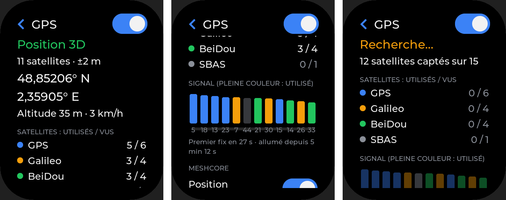

# GPS — position, satellites, annonces MeshCore

**Français** · [English](../en/gps.md)

L'app **GPS** allume ou coupe le récepteur GNSS de la montre (u-blox MIA-M10Q : GPS,
Galileo, BeiDou, QZSS et SBAS) et montre ce qu'il voit : état du fix, position, altitude,
vitesse, satellites utilisés et vus par constellation, force du signal des 12 plus forts.
Elle règle aussi la position donnée dans les **annonces MeshCore**.

## Utilisation

| Où | Action |
|---|---|
| Interrupteur en haut à droite | allume / coupe le GPS (mémorisé, il reste allumé app fermée) |
| *Position 3D* / *Recherche…* | état du fix ; dessous, satellites utilisés et précision (≈ 2,5 m × HDOP) |
| *Satellites : utilisés / vus* | une ligne par constellation présente |
| *Signal* | les 12 satellites les plus forts (dB-Hz) ; couleur de la constellation, pâle s'il n'est pas utilisé ; numéro dessous |
| *MeshCore › Position* | position dans les annonces de la montre (voir plus bas) |

Le premier fix prend de 30 s à quelques minutes à ciel ouvert (bien moins près d'une
fenêtre qu'à l'intérieur). Une fois coupé, le module garde en mémoire l'almanach et l'heure
(alimentation de sauvegarde permanente) : rallumé dans les heures qui suivent, le fix
revient en quelques secondes.

Avec un fix, la montre se remet à l'heure du GPS (écart de plus de 2 s, au plus toutes les
6 h), même sans iPhone.

## Énergie

- **Coupé** (par défaut) : alimentation du module coupée, broches en haute impédance, aucune
  tâche. Rien ne consomme.
- **Allumé, app fermée** : le module suit les satellites en continu ; l'ESP32 garde son light
  sleep et ne lit les trames que **2 s toutes les 30 s**. Compter la consommation du module
  (≈ 25 à 35 mA en recherche, un peu moins ensuite) en plus de celle de la montre.
- **App ouverte** : lecture continue, l'écran se rafraîchit chaque seconde.

## MeshCore

- **Position dans les annonces** : c'est le réglage *partager la position* de l'app MeshCore de
  l'iPhone (le même, des deux côtés). Activé, chaque annonce de la montre porte la position du
  dernier fix (moins de 2 minutes) ; GPS coupé ou sans fix, la dernière position connue. Coupé,
  les annonces ne donnent aucune position.
- La position du GPS est aussi mémorisée par MeshCore (au premier fix, puis tous les 200 m, au
  plus une écriture par quart d'heure) : elle sert après un redémarrage.
- **App MeshCore de l'iPhone** : la variable personnalisée `gps` (réglages de l'appareil)
  allume et coupe le même GPS. La télémétrie de position est envoyée aux contacts autorisés
  (réglage *télémétrie de position* de l'app).

## Détails techniques

UART1 à 38 400 bauds (TX 43, RX 44), trames NMEA 4.11 : RMC, GGA, GSA, GSV (GLL et VTG coupées
au démarrage par UBX-CFG-VALSET). Lecteur NMEA testé sur PC (`host_tests/test_gnss.c`).
Rail BLDO1 (3,3 V) ; VRTC alimente la sauvegarde du module en permanence.
