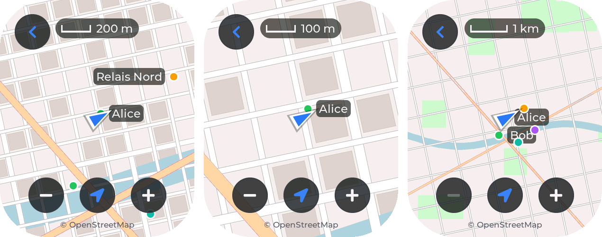

# Cartes — tuiles OpenStreetMap sur la carte SD

**Français** · [English](../en/maps.md)

L'app **Cartes** affiche des cartes OpenStreetMap rangées sur la carte micro-SD, sans réseau :
votre position GPS (flèche dans le sens de la marche) et les nœuds MeshCore qui annoncent la
leur (contacts, répéteurs, salons, capteurs).



*Captures du simulateur PC, avec des tuiles de démonstration (données inventées).*

## Utilisation

| Où | Action |
|---|---|
| Glisser | déplace la carte (avec élan) ; le suivi de la position s'arrête |
| Pincer, ou toucher deux fois | zoom avant / arrière autour des doigts |
| **−** / **+** | zoom arrière / avant (grisé au bout) |
| **➤** (en bas au centre) | recentre sur vous et suit la position (bleu : suivi actif). GPS coupé, il l'allume |
| Toucher un nœud | son nom, sa distance et l'âge de son annonce |
| **‹** ou bouton de la montre | retour (glisser vers la droite déplace la carte) |

- **Moi** : flèche bleue dans le sens de la marche (au-dessus de 2,5 km/h), rond bleu à
  l'arrêt ; gris quand la position date (pas de fix depuis 10 s). Disque pâle : la précision,
  quand elle dépasse le repère.
- **Nœuds MeshCore** : vert discussion, orange répéteur, violet salon, turquoise capteur. Les
  noms ne se chevauchent pas : un nom qui n'a pas la place n'est pas écrit (toucher le point).
  La liste se relit toutes les 15 s.
- **Échelle** en haut, au centre.
- À la première ouverture, la carte se centre sur votre position, sinon sur celle de MeshCore,
  sinon au milieu des tuiles présentes. Elle garde ensuite sa vue jusqu'au redémarrage.
- On peut zoomer **deux niveaux au-delà** du plus détaillé présent sur la carte : la tuile est
  agrandie. Une tuile absente est remplacée par un morceau agrandi d'un niveau plus large
  (jusqu'à 4 niveaux) : la carte reste lisible même incomplète.

## Préparer la carte SD

Même format que MCLite et le firmware MeshCore du T-Deck : les cartes déjà préparées pour
eux servent telles quelles.

```
/tiles/<zoom>/<x>/<y>.png
```

- Tuiles « slippy map » de 256 × 256 pixels (512 × 512 acceptées, réduites de moitié) ;
  PNG palette, gris, RGB ou RGBA, non entrelacés.
- Les niveaux de zoom présents sont détectés tout seuls. Pour une ville, 12 à 16 suffisent
  (de quelques Mo à quelques dizaines) ; 17 et 18 pour les rues en détail, beaucoup plus gros.
- Outil conseillé : [map-tiles-downloader](https://github.com/tekk/map-tiles-downloader)
  (choisir la zone et les niveaux, copier le dossier `tiles` à la racine de la carte SD).
  Copier par l'USB (Réglages › Carte SD › partager avec le PC) ou avec un lecteur de carte.
- **Licence et usage** : les données sont © les contributeurs d'OpenStreetMap (ODbL). Le
  serveur officiel `tile.openstreetmap.org` **interdit le téléchargement en masse** : utiliser
  un fournisseur de tuiles qui le permet, ou générer ses tuiles soi-même.

Sans carte SD, sans dossier `tiles` ou carte prêtée au PC, l'app le dit à l'écran ; elle
relit la carte dès qu'elle revient.

## Énergie et mémoire

- App ouverte, le GPS (s'il est allumé) est lu en continu, comme dans l'app GPS.
- Les tuiles décodées vivent en **PSRAM** (cache de 12 à 20 tuiles, ≈ 128 Ko chacune, en
  laissant 1,5 Mo au reste de la montre), libérées à la fermeture. Rien en RAM interne.
- La carte SD n'est tenue que le temps de lire un fichier : MeshCore (même bus SPI) continue
  de recevoir.

## Détails techniques

- `main/maptiles.c` : tâche « tiles » (pile en PSRAM : la carte SD n'est pas la flash), cache
  LRU, file par priorité (centre de l'écran d'abord, puis une couronne d'avance), lecture des
  niveaux et du centre de la zone couverte.
- `main/png_tile.c` : décodeur PNG → RGB565, décompression par le `tinfl` de la ROM de
  l'ESP32-S3 (aucun code zlib ajouté). Testé sur PC (`host_tests/test_png.c` : tous les
  formats, fichiers tronqués ou abîmés).
- `main/app_map.c` : un seul objet LVGL dessine tuiles, nœuds, position et échelle. Pendant
  le chargement d'une tuile, la tuile voisine d'un autre niveau déjà en cache est dessinée à
  l'échelle : le zoom ne montre pas de trou.
- Pincement : le contrôleur tactile (CST9217) suit deux doigts ; `display_touch_second()`
  donne le second.
