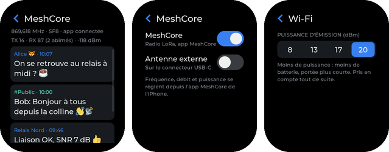

# MeshCore — messages LoRa depuis la montre

**Français** · [English](../en/meshcore.md)

La montre est un **nœud compagnon MeshCore** : sa radio LoRa SX1262 rejoint le réseau maillé
[MeshCore](https://meshcore.co.uk), et l'**app MeshCore** officielle de l'iPhone s'y connecte
en Bluetooth pour lire et envoyer des messages, gérer contacts et canaux, et régler la radio.
Le protocole est celui du firmware compagnon d'origine (v1.18.0) : l'app voit la montre comme
n'importe quel appareil MeshCore.

## Activation

1. Montre : *Réglages › MeshCore*, activer **MeshCore**. La radio LoRa démarre et la montre
   annonce le service Bluetooth MeshCore en plus des siens.
2. iPhone : la montre doit déjà être appairée (*Réglages › Bluetooth › Appairer un iPhone*,
   voir le [README](../../README.fr.md)). Ouvrir l'app MeshCore et se connecter à
   **T-Watch-Ultra**. C'est le même lien Bluetooth que les notifications : rien d'autre à
   appairer.

Le premier démarrage crée l'identité du nœud (clés) et l'enregistre sur la montre. Les
contacts (350 au plus), les canaux (40 au plus) et les réglages radio sont stockés dans la
partition `storage` et survivent aux redémarrages et aux mises à jour.

## Réglages radio

Préréglage par défaut : **EU/UK Narrow**, 869,618 MHz, bande de 62,5 kHz, SF8, CR 4/8,
22 dBm. Tous les paramètres radio (fréquence, bande, facteur d'étalement, codage, puissance)
se règlent **depuis l'app MeshCore** et sont enregistrés sur la montre ; la montre les
affiche sans les modifier.

**Antenne** : *Réglages › MeshCore › Antenne externe* bascule entre l'antenne intégrée
(coupé) et une antenne sur le connecteur USB-C (activé). Effet immédiat.

## L'app MeshCore de la montre

L'app **MeshCore** (la première de la liste) affiche :

- une ligne d'état : fréquence et facteur d'étalement, puis *app connectée*, ou le nombre de
  messages en attente pour l'app ;
- une ligne radio : paquets émis (`TX`, avec les ratés), reçus (`RX`, avec les abîmés) et le
  bruit de fond en dBm. Si la radio n'a pas pu démarrer, la ligne dit pourquoi ;
- les derniers messages, du plus récent au plus ancien : les messages directs sous le nom du
  contact, ceux des canaux sous `#canal`. Emoji et tout texte UTF-8 s'affichent comme sur le
  téléphone.

La montre garde les 64 derniers messages (enregistrés en flash : ils survivent à un redémarrage) et en affiche 30. **Lire un message sur
la montre ne le retire pas à l'app** : il reste dans la file de l'app (256 messages au plus)
et lui est remis quand elle se connecte.

Quand MeshCore est coupé, l'app propose un bouton pour l'activer.

Pendant une mise à jour par Wi-Fi, MeshCore continue de recevoir (le Bluetooth est coupé :
l'app iPhone ne peut pas se connecter en attendant) ; la file et l'historique sont
enregistrés avant le redémarrage de la montre.

## Consommation

MeshCore activé, la radio écoute en permanence : l'autonomie baisse nettement. Le couper
dans *Réglages › MeshCore* quand il ne sert pas ; l'alimentation de la radio est alors
coupée.

Le SX1262 partage son bus SPI avec la carte SD et la puce NFC : tant que la radio tourne,
leurs alimentations restent allumées, sélection de puce au niveau haut, sinon les puces non
alimentées tirent le bus vers le bas et la radio ne répond plus (détails dans les
[notes matérielles](hardware.md)).

## Dépannage

| Ce que l'on voit | Signification |
|---|---|
| *Radio LoRa arrêtée : ESP_ERR_NOT_FOUND* | Le SX1262 ne répond pas sur le bus SPI. Couper puis réactiver MeshCore ; le journal série (lignes `sx1262:`) donne l'état de la puce. |
| `TX` augmente mais personne ne vous entend | Vérifier le réglage d'antenne, et que le préréglage est celui du réseau local. |
| `RX` reste à 0 | Idem ; un bruit de fond vers −120 dBm est normal, beaucoup plus haut signale un brouillage local. |
| L'app ne voit pas la montre | MeshCore doit être activé, et la montre appairée avec cet iPhone. |

## Pas encore

Alertes de message (bandeau et vibration), historique sur la carte SD, réception basse
consommation, et liaison TCP pour les clients sur ordinateur.
