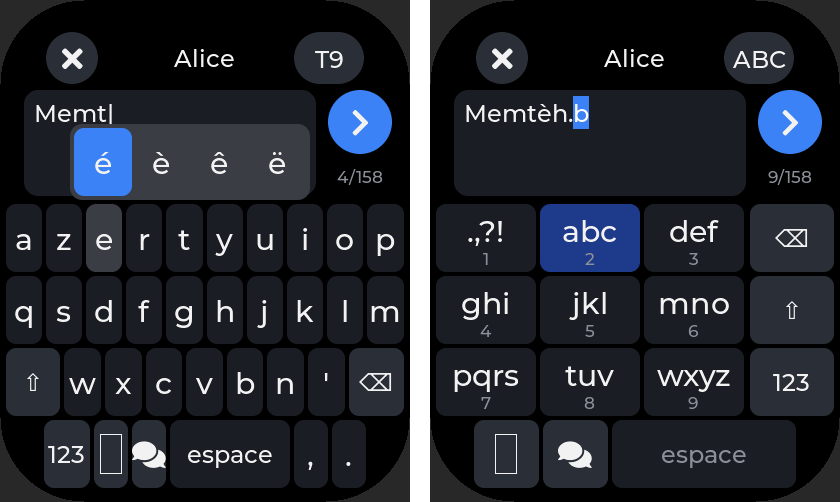
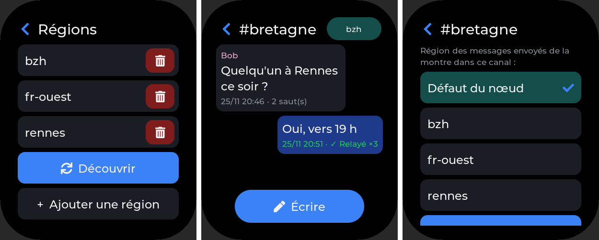

# MeshCore — messages LoRa depuis la montre

**Français** · [English](../en/meshcore.md)

La montre est un **nœud compagnon MeshCore** : sa radio LoRa SX1262 rejoint le réseau maillé
[MeshCore](https://meshcore.co.uk), et l'**app MeshCore** officielle de l'iPhone s'y connecte
en Bluetooth pour lire et envoyer des messages, gérer contacts et canaux, et régler la radio.
Le protocole est celui du firmware compagnon d'origine (v1.18.0) : l'app voit la montre comme
n'importe quel appareil MeshCore.


## Activation

1. Montre : *Réglages › MeshCore*, activer **MeshCore**. La radio LoRa démarre et la montre
   annonce le service Bluetooth MeshCore en plus des siens.
2. iPhone : la montre doit déjà être appairée (*Réglages › Bluetooth › Appairer un iPhone*,
   voir le [README](../../README.fr.md)). Ouvrir l'app MeshCore et se connecter à
   **T-Watch-Ultra**. C'est le même lien Bluetooth que les notifications : rien d'autre à
   appairer.

Le premier démarrage crée l'identité du nœud (clés) et l'enregistre sur la montre. Les
contacts (350 au plus), les canaux (40 au plus) et les réglages radio sont stockés dans la
partition `storage` et survivent aux redémarrages et aux mises à jour.

## Réglages radio

Préréglage par défaut : **EU/UK Narrow**, 869,618 MHz, bande de 62,5 kHz, SF8, CR 4/8,
22 dBm. Tous les paramètres radio (fréquence, bande, facteur d'étalement, codage, puissance)
se règlent **depuis l'app MeshCore** et sont enregistrés sur la montre ; la montre les
affiche sans les modifier.

**Antenne** : en haut de l'onglet **Radio** de l'app MeshCore (*Intégrée* / *Externe*), ou
*Réglages › MeshCore › Antenne externe*. Externe : antenne sur le connecteur USB-C. Effet
immédiat.

## L'app MeshCore de la montre

L'app **MeshCore** (la première de la liste) a trois onglets :

- **Contacts** : les contacts de discussion et les salons, plus les conversations dont le
  contact a été supprimé depuis ;
- **Canaux** : les canaux réglés dans l'app iPhone ;
- **Radio** : boutons **Annonce flood** (relayée par tout le réseau) et **Annonce locale**
  (0 saut), nom du nœud, fréquence, SF et puissance, état de l'app iPhone (connectée, à
  jour, ou nombre de messages qui l'attendent), compteurs radio (`TX` avec les ratés, `RX`
  avec les abîmés, bruit de fond) et état de la carte SD.

Les listes mettent en tête les conversations qui ont des **non lus**, puis le canal
**Public** (le canal de MeshCore à la clé connue de tous), puis suivent l'ordre
**alphabétique** (émojis et ponctuation en début de nom ignorés, sans majuscules ni accents).
Chaque ligne montre le dernier message, son heure et une pastille avec le nombre de non lus ;
le titre des onglets compte aussi les non lus. Au-delà de 40 lignes, *Afficher plus* charge
la suite.

Pour un contact, la ligne montre aussi son **chemin**, comme l'app iPhone : *direct*,
*2 saut(s)*, ou *flood* quand aucun chemin n'est connu. **Rechercher…**, en haut des onglets
Contacts et Canaux, ouvre le clavier : la liste ne garde que les noms qui contiennent le texte
tapé (sans majuscules ni accents). Toucher le filtre l'efface.

Toucher une ligne fait **glisser la conversation** : bulles, les plus anciennes en haut, nom
de l'expéditeur sur les canaux, messages envoyés depuis l'iPhone à droite, repère *Non lus*.
*Messages plus anciens* remonte dans l'historique (montre, puis carte SD). Retour : la flèche,
un glissé vers la droite ou le bouton. Émojis et tout texte UTF-8 s'affichent comme sur le
téléphone.

### Écrire depuis la montre

En bas de chaque conversation, **Écrire** ouvre le clavier en plein écran. Il marche avec
tout contact ou canal, même sans message.



- **Clavier complet** (AZERTY ou QWERTY, *Réglages › MeshCore*) : la touche retenue est celle
  sous le doigt **au lâcher**, montrée en grand au-dessus ; on peut donc glisser pour
  corriger. **Appui long** sur e, a, c, i, o, u, y, n, ' ou . : les accents (é è ê ë…),
  glisser dessus puis lâcher. Majuscule automatique en début de phrase ; ⇧ deux fois :
  verrouillage. *123* : chiffres et symboles.
- **T9** : touches géantes. Toucher plusieurs fois la même touche fait défiler ses lettres
  (2 : a b c 2 à â ç) ; la lettre en cours est surlignée et se valide au bout d'une seconde ou
  avec une autre touche. Appui long : le chiffre.
- Le bouton en haut à droite passe de l'un à l'autre (**T9** / **ABC**) ; le dernier choisi
  revient la fois suivante.
- 🙂 : émojis courants. 💬 : **réponses rapides** (« OK 👍 », « J'arrive », « Où es-tu ? »…).
- Le compteur montre les octets utilisés (158 en privé ; sur un canal, le nom du nœud en
  prend une partie). Le brouillon reste si on ferme sans envoyer.

**État de l'envoi**, sous chaque message écrit sur la montre, comme dans l'app iPhone :

| | Privé | Canal |
|---|---|---|
| en cours | *Envoi… 2/3* (tentative) | *Envoyé, en attente de relais* |
| réussi | *✓ Livré · 1,8 s* (accusé du destinataire, aller-retour) | *✓ Relayé ×3* (répétitions entendues) |
| raté | *✗ Échec* | *Aucun relais entendu* |

En privé, la montre **réessaie** tant que le destinataire n'a pas confirmé, jusqu'au nombre
de *Tentatives* des réglages (3 par défaut, comme l'app iPhone) ; la dernière repart en
inondation si le chemin direct reste muet. Les essais continuent **app fermée et écran
éteint**. Toucher un message en échec le renvoie.

L'app iPhone ne voit pas les messages écrits sur la montre : le protocole compagnon n'a pas
de trame pour ça. Ils restent dans l'historique de la montre et sur la carte SD (avec leur
état).

### Régions

Une région (*scope*) limite l'inondation d'un message aux répéteurs qui la connaissent. Le
nœud ne garde que sa région **par défaut** ; la liste des régions et le choix par canal de
l'app iPhone restent dans l'app. La montre a donc les siens :



- **Onglet Radio › Régions** : la liste. **Ajouter une région** ouvre le clavier (sans
  majuscule automatique ; le nom s'écrit sans #, comme « bzh »). La corbeille la retire.
- **Découvrir** demande leurs régions aux répéteurs des contacts joignables en direct : chemin
  connu (après un échange avec lui), ou chemin de sa dernière annonce entendue depuis le
  démarrage de la montre. 12 au plus, un toutes les 1,5 s. Les noms reçus entrent dans la
  liste et s'affichent sous le bouton. Un répéteur ne répond qu'en direct et limite ces
  requêtes.
- Dans un **canal**, le bouton en haut à droite montre la région de ses envois
  (*Région* : celle par défaut du nœud). Le toucher pour la choisir, ou en ajouter une.

La clé d'une région est calculée comme sur les répéteurs (SHA-256 de « #nom »). Les régions
privées ($) ne sont pas gérées. Les messages privés gardent la région par défaut.

### Lu et non lu

- Ouvrir une conversation sur la montre la marque **lue**.
- Un message que l'app iPhone a **récupéré**, ou une conversation où l'on vient d'**écrire**
  depuis l'app, passe en lu sur la montre.
- **Lire un message sur la montre ne le retire pas à l'app** : il reste dans sa file (256
  messages au plus) et lui est remis quand elle se connecte. Le protocole MeshCore ne sait pas
  dire à l'app qu'un message est lu : il y apparaît donc comme nouveau.

### Historique et carte SD

La montre garde les **128 derniers messages** (reçus, et envoyés depuis l'app), avec leur état
lu / non lu, en mémoire et en flash : ils survivent à un redémarrage. Avec une **carte
micro-SD**, chaque message y est aussi archivé, un fichier par conversation dans `/meshcore`,
et les plus anciens se relisent depuis la carte.

Les fichiers d'archive (`c-<clé>.jsonl` pour un contact, `g-<clé>.jsonl` pour un canal) sont
en JSON Lines, lisibles sur PC : une ligne par message, complétée par des espaces à 512 octets
pour que la montre puisse sauter directement aux plus anciens. Par exemple :

```json
{"seq":42,"ts":1764000000,"time":"2026-11-24 17:00","dir":"in","conv":"#fr","sender":"Bob","text":"Salut","snr":-5.25,"hops":3}
```

`ts` est l'horodatage de l'expéditeur (UTC), `time` la même heure en heure locale, `dir`
`in` (reçu) ou `out` (envoyé depuis l'app), `sender` l'auteur sur un canal, `hops` 0 pour un
message direct. Avec `jq` : `jq -r '.time + " " + .sender + " " + .text' g-*.jsonl`. Les
anciens fichiers `.bin` (0.2.15 à 0.2.19) ne sont plus lus.

La carte est détectée à l'insertion (en 3 s environ, 15 s écran éteint), montée tout de suite
et démontée si on la retire. *Réglages › Carte SD* affiche l'espace libre et propose **Éjecter la carte** (les
tampons sont écrits, puis la carte est démontée : on peut la retirer) et **Remonter la carte**.
Elle doit être formatée en FAT32. Le journal de la montre y est aussi écrit, dans
`/logs/AAAA-MM-JJ.log`. Pour ménager la carte et la batterie, journal et archive restent en
mémoire et ne sont écrits que toutes les 10 minutes (plus tôt si le journal se remplit), ainsi
qu'avant un redémarrage, une éjection ou un partage.

**Partager avec le PC** apparaît quand la montre est branchée à un ordinateur : la carte y
apparaît comme une clé USB, en lecture et en écriture (environ 1 Mo/s, le bus est partagé avec
la radio). Pendant le partage, la montre n'écrit plus sur la carte (journaux et messages
attendent en mémoire, MeshCore continue de recevoir) et la console série USB est coupée.
**Éjecter le disque sur le PC** rend la carte à la montre, qui la remonte ; *Arrêter le
partage*, le débranchement du câble ou le retrait de la carte aussi, mais sans éjection côté PC
ses dernières écritures peuvent être perdues.

Quand MeshCore est coupé, l'app propose un bouton pour l'activer.

Pendant une mise à jour par Wi-Fi, MeshCore continue de recevoir (le Bluetooth est coupé :
l'app iPhone ne peut pas se connecter en attendant) ; la file et l'historique sont
enregistrés avant le redémarrage de la montre.

## Consommation

MeshCore activé, la radio écoute en permanence : l'autonomie baisse nettement. Le couper
dans *Réglages › MeshCore* quand il ne sert pas ; l'alimentation de la radio est alors
coupée.

Le SX1262 partage son bus SPI avec la carte SD et la puce NFC : tant que la radio tourne,
leurs alimentations restent allumées, sélection de puce au niveau haut, sinon les puces non
alimentées tirent le bus vers le bas et la radio ne répond plus (détails dans les
[notes matérielles](hardware.md)).

## Dépannage

| Ce que l'on voit | Signification |
|---|---|
| *Radio LoRa arrêtée : ESP_ERR_NOT_FOUND* | Le SX1262 ne répond pas sur le bus SPI. Couper puis réactiver MeshCore ; le journal série (lignes `sx1262:`) donne l'état de la puce. |
| `TX` augmente mais personne ne vous entend | Vérifier le réglage d'antenne, et que le préréglage est celui du réseau local. |
| `RX` reste à 0 | Idem ; un bruit de fond vers −120 dBm est normal, beaucoup plus haut signale un brouillage local. |
| L'app ne voit pas la montre | MeshCore doit être activé, et la montre appairée avec cet iPhone. |

## Pas encore

Alertes de message (bandeau et vibration), saisie prédictive en T9, réception basse
consommation.
