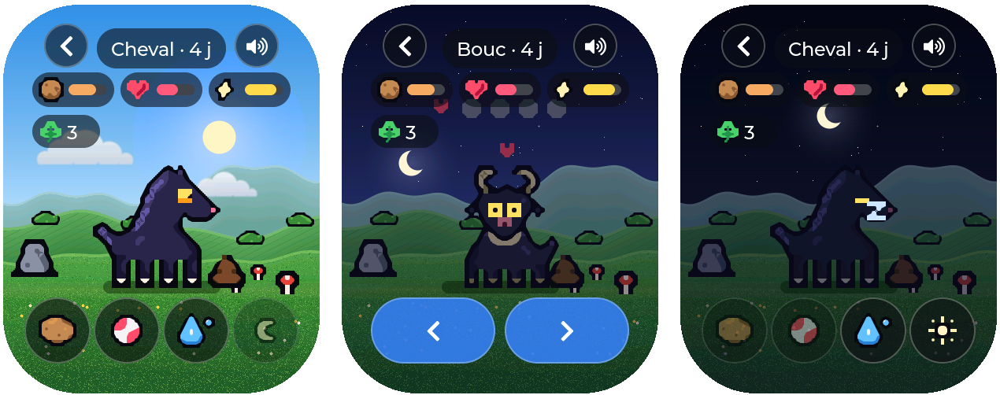
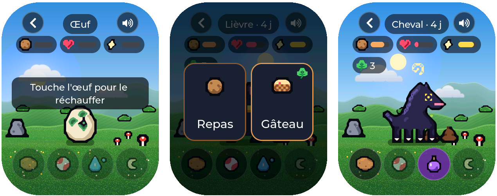

# Púca — l'animal virtuel

**Français** · [English](../en/puca.md)

Le *púca* est un esprit farceur du folklore irlandais qui change de forme : lièvre, cheval,
bouc… L'app **Púca** en fait un petit compagnon en pixel art à faire éclore, nourrir, distraire
et soigner. Sa forme adulte dépend de la façon dont tu t'en occupes.

## Écran

| Où | Quoi |
|---|---|
La scène occupe tout l'écran, coins arrondis compris. Le décor est dessiné en pleine
résolution (ciel en dégradé, montagnes, collines, pré fleuri) et le púca est agrandi ×6 avec
des contours lissés ; il projette une ombre douce sur l'herbe.

| Où | Quoi |
|---|---|
| En haut | bouton retour, stade et âge (*Bébé · 5 h*, *Cheval · 4 j*), son des effets (bouton haut-parleur) |
| Jauges | satiété (pomme de terre), humeur (cœur), énergie (éclair) |
| Scène | ciel qui suit l'heure et la saison (aube et crépuscule aux vrais lever et coucher du soleil, soleil ou lune qui traversent le ciel, nuit étoilée, nuages), le púca qui se promène, ses crottes ; trèfles en haut à gauche |
| En bas | quatre gros boutons ronds : **nourrir**, **jouer**, **soins**, **lumière** |

## Sa vie

1. **L'œuf** : le toucher six fois pour le réchauffer ; il se fissure, puis éclot.
2. **Bébé** pendant 24 h, **jeune** jusqu'à 72 h, puis **adulte**. À chaque passage, une
   petite mise en scène (les deux silhouettes s'échangent, éclair de lumière).
3. **Forme adulte**, selon la moyenne des soins depuis l'éclosion :
   - **lièvre** — bien soigné (≥ 60 %) et tu marches beaucoup (≥ 5000 pas par jour en moyenne) ;
   - **cheval** — bien soigné ;
   - **bouc** ronchon — soins négligés.
4. Il **s'endort seul à 22 h** et se réveille à 7 h. Dès le coucher du soleil (ou 20 h), le
   bouton lune le **met au lit plus tôt**, lumière éteinte. Lumière éteinte il récupère mieux ;
   laissée allumée, il dort mal. Rallumer avant 22 h le réveille. Elle se rallume seule le matin.

Rien ne tourne en tâche de fond : à l'ouverture de l'app, sa vie depuis ta dernière visite est
calculée d'un coup, par pas de 5 minutes (au plus 7 jours). Aucun coût sur la batterie.

## S'en occuper

| Action | Effet |
|---|---|
| **Nourrir › Repas** (pomme de terre) | satiété +35 % ; refusé s'il n'a pas faim. Trois heures plus tard… une crotte |
| **Nourrir › Gâteau** | humeur +25 %, coûte un **trèfle** ; pas plus de trois en deux heures |
| **Jouer** : *gauche ou droite ?* | cinq manches : devine de quel côté il va regarder. 3 réussies ou plus : humeur +30 % et **un trèfle**. Fatigue un peu ; impossible s'il est malade ou épuisé |
| **Soins** (eau ou potion) | malade, il le guérit (le bouton devient violet, avec une potion) ; sinon il enlève les crottes (le bouton se colore en brun dès deux crottes) |
| **Lumière** (lune) | le soir : le coucher ; endormi : éteindre ou rallumer |
| **Le caresser** (toucher le púca) | petit bond et un cœur |

**Trèfles** : un trèfle par tranche de 1000 pas du jour (compteur de pas activé dans
*Réglages › Mouvement*), un trèfle par partie gagnée.

**Ce qui le rend malade** : rester affamé 4 h, ou au milieu de trois crottes 3 h. Malade, son
humeur et son énergie baissent plus vite et un tourbillon tourne au-dessus de sa tête.

**S'il est abandonné** (affamé et malheureux 48 h d'affilée), il retourne au tertre des fées :
un nouvel œuf t'attend.

Les jauges baissent pendant la journée : la satiété se vide en une dizaine d'heures, l'humeur en
un peu plus. La nuit, la faim se creuse beaucoup moins et l'énergie remonte.
