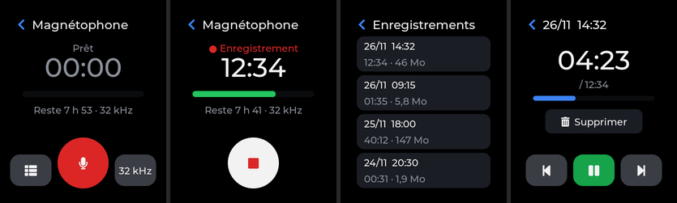

# Magnéto — enregistrer avec le micro

**Français** · [English](../en/recorder.md)

L'app **Magnéto** enregistre le micro de la montre sur la **carte micro-SD**, même **écran
éteint**, et relit les enregistrements sur le haut-parleur.

## Format

- **WAV**, PCM 16 bits mono : lisible partout (ordinateur, téléphone, logiciels de montage),
  sans perte et sans calcul pour la montre (le processeur reste au plus bas, ce qui ménage la
  batterie mieux qu'un encodage MP3).
- **32 kHz** par défaut (haute qualité, bande passante jusqu'à 16 kHz) : ≈ 230 Mo par heure.
- **16 kHz** au choix (voix) : ≈ 115 Mo par heure, deux fois plus de durée.
- Fichiers dans le dossier **REC** de la carte, nommés par la date et l'heure de début :
  `REC/20261126-143205.WAV`.
- Gain automatique (jusqu'à +36 dB, descente immédiate sur un son fort, remontée lente),
  filtre coupe-bas à 80 Hz contre le souffle du vent et les chocs.

## Utilisation

| Où | Action |
|---|---|
| Gros bouton rouge (micro) | **démarrer** l'enregistrement |
| Gros bouton blanc ■ | **arrêter** : le fichier est fermé proprement sur la carte |
| *32 kHz* / *16 kHz* | changer la qualité (mémorisée) |
| ≡ | liste des **enregistrements**, du plus récent au plus ancien |
| Une ligne de la liste | ouvre le lecteur et lance la lecture |
| ◀◀ / ▶▶ (lecteur) | reculer / avancer de 10 s |
| ▶ / ❚❚ (lecteur) | lecture / pause |
| *Supprimer* (lecteur) | toucher deux fois (*Confirmer*) pour effacer le fichier |
| Bouton latéral | écran éteint, **l'enregistrement continue** ; un nouvel appui y revient |
| Glisser → ou ‹ | quitter l'app : **l'enregistrement continue** ; rouvrir l'app pour le voir ou l'arrêter |

- La barre verte montre le niveau ; *Reste 7 h 40* indique ce que la carte peut encore
  contenir à la qualité choisie.
- Bips et notifications sonnent toujours pendant un enregistrement (ils seront audibles dans le
  fichier).
- Pour récupérer les fichiers : **partage USB** de la carte (câble branché, Réglages → Carte SD)
  ou **serveur web** de la montre, onglet *Fichiers*, dossier `REC`.

## Fiabilité

- Les échantillons passent par une réserve de 8 s en PSRAM, puis sont écrits par blocs de
  64 Ko alignés sur les secteurs : peu d'écritures, et une carte lente ne fait pas perdre de son.
- L'en-tête WAV est mis à jour et le fichier validé toutes les **30 s** : en cas de plantage, de
  batterie vide ou de carte retirée, seules les dernières secondes sont perdues. La lecture sur
  la montre se fie à la taille réelle du fichier.
- Carte pleine : l'enregistrement s'arrête et reste sur la carte (2 Mo sont laissés libres).
  Taille maximale d'un fichier : 3,75 Go (≈ 16 h à 32 kHz).

## Énergie

Pendant l'enregistrement, le light sleep est suspendu (l'horloge du micro doit tourner) mais
le processeur reste à sa fréquence la plus basse ; la carte SD reste alimentée. Hors
enregistrement, le micro et son horloge sont coupés.

## Côté technique

Micro MEMS PDM (horloge GPIO 17, données GPIO 18) sur **I2S0**, le seul port de l'ESP32-S3
qui sait convertir le PDM en PCM ; le haut-parleur est passé sur I2S1. Horloge PDM ≈ 2 MHz
(32 kHz × 64 ou 16 kHz × 128). Code : `main/recorder.c` (moteur), `main/app_rec.c` (écran).
