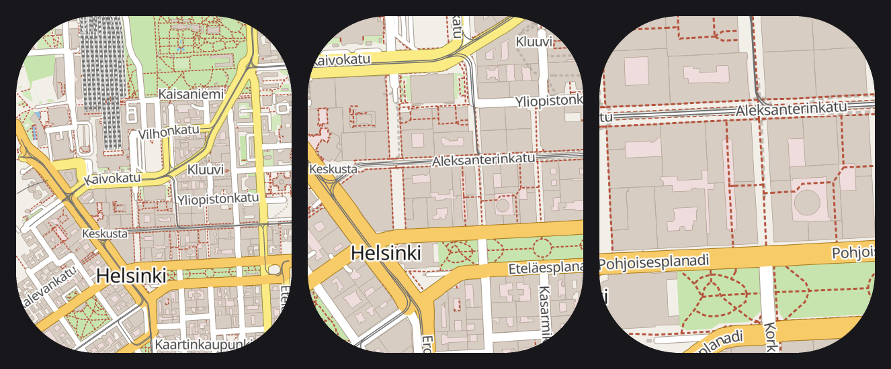

# Cartes hors ligne — fabriquer les tuiles

**Français** · [English](../en/tiles.md)

L'app **Cartes** lit des tuiles PNG sur la carte micro-SD (`/tiles/<zoom>/<x>/<y>.png`).
Le script `tools/tuiles/generer-tuiles.sh` les fabrique sur le PC à partir d'un extrait
OpenStreetMap de [Geofabrik](https://download.geofabrik.de) (la France, une région, un pays),
avec un style fait pour l'écran de la montre : gros libellés, routes larges et contrastées,
peu de détails inutiles. Une seule commande, rien à installer à part Docker.



*Aperçu sur un petit extrait de test (Helsinki), aux dimensions de l'écran.*

## Ce qu'il faut

- **Linux** avec **Docker** (`sudo apt install docker.io`, puis
  `sudo usermod -aG docker $USER` et se reconnecter).
- Pour la **France entière** : environ **12 Go** de disque libre (extrait 4,5 Go, trait de côte
  et Natural Earth 1,3 Go, tuiles vectorielles 3 à 4 Go) et **8 Go de RAM** au moins.
  Pour une région (Bretagne, Normandie…), dix fois moins.
- Une connexion Internet pour le premier lancement (extrait, images Docker, données de côte).

## Utilisation

Depuis le dossier du dépôt :

```sh
# La France jusqu'au niveau 12, et 25 km autour de Rennes en détail (niveaux 13 à 16)
tools/tuiles/generer-tuiles.sh --detail 48.11,-1.68,25

# Pareil, et copie directe sur la carte SD montée
tools/tuiles/generer-tuiles.sh --detail 48.11,-1.68,25 --sd /media/$USER/MONTRE

# Juste compter les tuiles et la place, sans rien dessiner
tools/tuiles/generer-tuiles.sh --detail 48.11,-1.68,25 --estimer

# Une seule région, détaillée partout jusqu'au niveau 14
tools/tuiles/generer-tuiles.sh --region europe/france/bretagne --zooms 0-14

# Deux zones détaillées (domicile et vacances), la seconde jusqu'au niveau 17
tools/tuiles/generer-tuiles.sh --detail 48.11,-1.68,25 --detail 43.30,5.37,10,13-17
```

Ce qui se passe :

1. **Téléchargement** de l'extrait Geofabrik (seulement s'il y a plus récent), vérifié par sa
   somme MD5. Rangé dans `~/.cache/twatch-tuiles`.
2. **Estimation** : nombre de tuiles par niveau et place sur la carte SD. Si ça ne rentre pas,
   le script s'arrête là et dit quoi réduire (`--forcer` pour passer outre).
3. **Tuiles vectorielles** avec [Planetiler](https://github.com/onthegomap/planetiler) (schéma
   OpenMapTiles), une seule fois par extrait : 15 à 30 min pour la France sur un PC récent.
   Le premier lancement télécharge aussi le trait de côte et Natural Earth (≈ 1,3 Go, gardés).
4. **Dessin** des tuiles PNG 256 × 256 dans `./tuiles-montre/tiles` (MapLibre Native, palette
   de 128 couleurs). La progression et le temps restant s'affichent. Compter de l'ordre d'une
   heure pour la France jusqu'au niveau 12 avec une zone détaillée.
5. Avec `--sd` : **copie** sur la carte, puis `sync`. Éjecter la carte avant de la retirer.

Interrompu (Ctrl+C, coupure), il suffit de relancer **la même commande** : le dessin reprend
où il s'était arrêté. `--refaire` force à tout redessiner. Pour mettre la carte à jour plus
tard, relancer : un extrait plus récent est retéléchargé et tout est refait.

## Options

| Option | Rôle |
|---|---|
| `-r, --region NOM` | extrait Geofabrik, chemin de son URL : `europe/france` (défaut), `europe/france/bretagne`, `europe/belgium`… |
| `-p, --pbf FICHIER` | extrait `.osm.pbf` déjà téléchargé |
| `-z, --zooms A-B` | niveaux pour tout l'extrait (défaut `0-12`) ; `aucun` pour ne faire que les zones |
| `-d, --detail LAT,LON,RAYON_KM[,A-B]` | zone détaillée autour d'un point (niveaux `13-16` par défaut), répétable |
| `-b, --bbox OUEST,SUD,EST,NORD[,A-B]` | zone détaillée en rectangle, répétable |
| `-s, --sd DOSSIER` | carte SD montée : sa place libre et sa taille de blocs servent à l'estimation, copie à la fin |
| `--taille T`, `--bloc B` | sans `--sd` : taille de la carte (défaut `2G`) et de ses blocs (défaut `32K`) |
| `-o, --sortie DOSSIER` | où écrire le dossier `tiles` (défaut `./tuiles-montre`) |
| `-n, --estimer` | estimation seulement |
| `--forcer`, `--refaire` | dessiner même si c'est trop gros ; tout redessiner |
| `-j, --jobs N` | dessins en parallèle (défaut : cœurs − 1) |
| `--memoire M` | mémoire Java de Planetiler (défaut : la moitié de la RAM) |
| `--style FICHIER` | autre style MapLibre |
| `--couleurs N` | couleurs de la palette PNG (défaut 128 ; moins = plus petit) |
| `-w, --travail DOSSIER` | cache (défaut `~/.cache/twatch-tuiles`) |

Les coordonnées s'obtiennent par un clic droit sur [openstreetmap.org](https://www.openstreetmap.org)
(« Afficher l'adresse ») ou dans l'app GPS de la montre.

## Que choisir pour une carte de 2 Go

Chaque niveau compte **quatre fois plus** de tuiles que le précédent :

| France entière | Tuiles | Place (blocs 32 Ko) | Place (blocs 4 Ko) |
|---|---|---|---|
| niveaux 0 à 11 | 9 400 | ≈ 300 Mo | ≈ 110 Mo |
| niveaux 0 à 12 | 37 000 | ≈ 1,2 Go | ≈ 420 Mo |
| niveau 13 en plus | + 110 000 | + 3,4 Go | + 1,3 Go |

| Zone détaillée, niveaux 13 à 16 | Tuiles | Place (blocs 32 Ko) | Place (blocs 4 Ko) |
|---|---|---|---|
| rayon 10 km | 3 300 | ≈ 100 Mo | ≈ 25 Mo |
| rayon 25 km | 20 500 | ≈ 650 Mo | ≈ 170 Mo |
| rayon 50 km | 80 000 | ≈ 2,5 Go | ≈ 650 Mo |

Ce sont des maximums : la mer et les pays voisins (vides, hors de l'extrait) ne sont pas écrits,
la montre agrandit la tuile parente à la place. Le niveau 12 montre les villages et les routes
principales, le 14 toutes les rues, le 16 les bâtiments et les sentiers. La montre zoome deux
niveaux plus loin que le plus détaillé présent, en agrandissant.

**Conseil** : la France de 0 à 12 et une zone de 25 km autour de chez soi, de 13 à 16.

### Formater la carte en FAT32 avec des petits blocs

Une carte de 2 Go est souvent livrée en FAT16 avec des blocs de **32 Ko** : une tuile de 8 Ko
en occupe alors 32. En **FAT32 avec des blocs de 4 Ko**, la même carte en contient trois fois
plus. Pour la reformater (**tout son contenu est effacé**, sauvegarder les dossiers `logs` et
l'historique MeshCore d'abord) :

```sh
lsblk -o NAME,SIZE,MODEL,MOUNTPOINT   # repérer la carte, ex. sdb (vérifier la taille !)
sudo umount /dev/sdb1
sudo mkfs.vfat -F 32 -s 8 -n MONTRE /dev/sdb1   # paquet dosfstools ; -s 8 = blocs de 4 Ko
```

Avec `--sd`, le script lit tout seul la taille des blocs de la carte.

## Le style

`tools/tuiles/style-montre.json` est un style MapLibre (schéma OpenMapTiles) : libellés de 16
à 30 pixels avec un contour blanc, routes colorées par importance et bordées, eau bleue
franche, bois et parcs verts, bâtiments à partir du niveau 15, sentiers en tirets rouges à
partir du niveau 15, chemins en tirets bruns. Pas de points d'intérêt (illisibles sur la
montre).

Il est généré par `tools/tuiles/style_montre.py` (couleurs, tailles et niveaux en tête de
fichier) : modifier le script, relancer `python3 tools/tuiles/style_montre.py
tools/tuiles/style-montre.json`, puis relancer le script de tuiles (le dessin est refait, les
tuiles vectorielles non). `--style` permet aussi d'essayer un autre style sans toucher au dépôt.

## Détails techniques

- `generer-tuiles.sh` : téléchargement, contrôle de la carte SD (`stat -f` : place libre,
  taille des blocs), Planetiler dans son image officielle
  (`ghcr.io/onthegomap/planetiler`, couches `poi` et `housenumber` exclues), puis le dessin.
- `render.cjs` tourne dans une image bâtie sur `maptiler/tileserver-gl` (MapLibre Native,
  sharp et la police Noto Sans y sont déjà) :
  - lit l'emprise de l'extrait dans l'en-tête du `.osm.pbf` pour estimer avant Planetiler ;
  - dessine des blocs de 8 × 8 tuiles d'un coup avec 128 pixels de marge, puis découpe :
    les libellés ne sont pas coupés entre deux tuiles voisines du même bloc ;
  - une tuile unie (mer, hors de l'extrait) dont la parente est unie de la même couleur n'est
    pas écrite, tant que la montre peut agrandir la parente (4 niveaux au plus,
    `MT_UPSCALE` dans `main/maptiles.h`) ;
  - écrit des PNG palette (lus par `main/png_tile.c`), un journal `.journal-tuiles` pour la
    reprise, et la place réelle sur la carte selon la taille de ses blocs.
- Tout tourne avec l'utilisateur courant : les fichiers créés lui appartiennent.

## Licences

Les cartes contiennent des données © les contributeurs d'OpenStreetMap, sous licence
[ODbL](https://www.openstreetmap.org/copyright), mises en forme selon le schéma
© OpenMapTiles (CC-BY 4.0). Police Noto Sans : SIL Open Font License. Planetiler : Apache 2.0,
TileServer GL et MapLibre Native : BSD. Ces logiciels ne sont pas copiés dans le dépôt : Docker
les télécharge.
