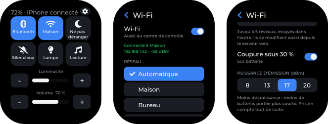
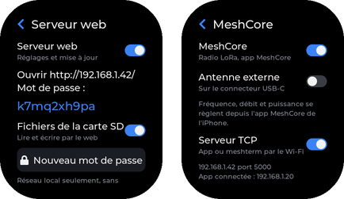
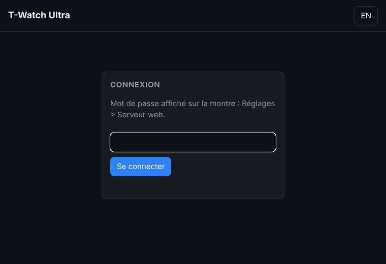
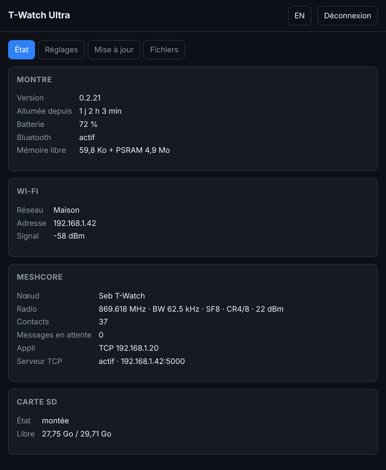
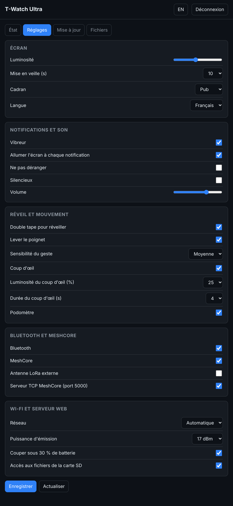
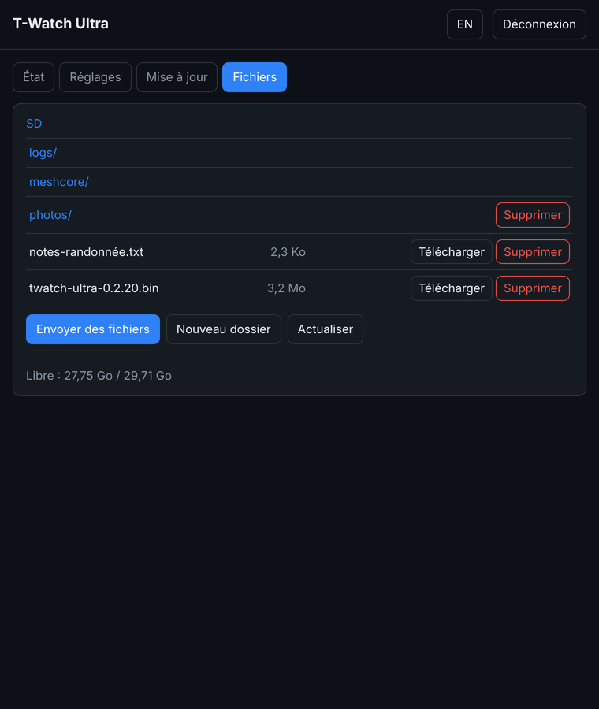

# Wi-Fi, serveur web et MeshCore en TCP

**Français** · [English](../en/wifi.md)

Depuis la 0.2.21, le Wi-Fi de la montre est géré en un seul endroit. On l'allume depuis le
centre de contrôle ou les réglages, et les apps qui en ont besoin (WebRX, Radio, analyseur
Wi-Fi) utilisent la connexion déjà établie, ou l'allument le temps de leur usage. Deux services
réseau peuvent tourner pendant que le Wi-Fi est allumé : un **serveur web** (réglages, mise à
jour, fichiers de la carte SD) et un **serveur TCP MeshCore** pour l'app MeshCore ou meshterm.
Tout est **coupé par défaut**.

## Allumer le Wi-Fi

- **Centre de contrôle** (glisser vers le bas depuis le cadran) : un toucher sur la tuile
  **Wi-Fi** ouvre le choix **Coupé / Client / Point d'accès**, avec l'état en dessous.
  Allumée, la tuile affiche le nom du réseau. Un **appui long** (ou la roue dentée du choix)
  ouvre les réglages Wi-Fi. Les réglages de la montre sont sous la petite roue dentée, en haut
  à droite.
- **Réglages › Wi-Fi** : interrupteur, **Client / Point d'accès**, état de la connexion
  (réseau, adresse IP, signal), choix du réseau, puissance d'émission et coupure sur batterie
  faible.

L'état et le mode choisis sont retenus au redémarrage.

### Point d'accès

Sans box à portée (en balade, en voiture), la montre crée son propre réseau
**T-Watch-Ultra** (WPA2, même mot de passe à 8 chiffres que la mise à jour, affiché dans le
choix du centre de contrôle et dans *Réglages › Wi-Fi*). Le téléphone s'y connecte et trouve
la montre à **192.168.4.1** : page web (`http://192.168.4.1/`) et MeshCore en TCP (port
5000), s'ils sont activés. Il n'y a pas d'accès à Internet par ce réseau. Jusqu'à 4
appareils ; le choix affiche combien sont connectés. Le point d'accès empêche le sommeil
léger de la montre : il consomme nettement plus que le mode client.

Une app qui a besoin d'Internet (Radio, WebRX, analyseur Wi-Fi) repasse le Wi-Fi en client le
temps de son usage, puis le point d'accès revient.

### Apps Internet

Radio et WebRX n'allument plus le Wi-Fi d'elles-mêmes : si le Wi-Fi n'est pas déjà allumé en
client, l'app affiche un gros bouton **Activer le Wi-Fi** (ou **Passer en client** si la
montre est en point d'accès). Il allume le Wi-Fi en client pour la durée de l'écoute
seulement ; le Wi-Fi reprend son état d'avant en quittant l'app. Si le Wi-Fi est déjà
connecté, l'écoute démarre directement comme avant.

### Réseaux

La montre retient jusqu'à **5 réseaux**. En mode *Automatique*, elle cherche les réseaux à
portée et essaie ceux qu'elle connaît dans l'ordre de la liste. On peut aussi en imposer un
seul (*Réglages › Wi-Fi › Réseau*).

Pour ajouter, modifier ou réordonner les réseaux :

- **depuis le serveur web** (onglet *Mise à jour › Réseaux Wi-Fi, WebRX et radios*), sans
  couper le Bluetooth ;
- ou **depuis la montre** : *Réglages › Wi-Fi › Modifier les réseaux*, puis *Démarrer*. La
  montre coupe le Bluetooth et crée son propre point d'accès, comme pour la mise à jour ; elle
  redémarre après l'enregistrement.

En cas d'échec, la montre réessaie seule après 5 s, 10 s, 30 s, 1 min, 2 min puis toutes les
5 min. Pendant les longues attentes la radio Wi-Fi est coupée pour ménager la batterie. Le
bouton **Réessayer** relance un essai tout de suite.

### Batterie et Bluetooth

- **Coupure sous 30 %** (activée par défaut) : sur batterie, le Wi-Fi s'éteint quand la
  charge passe sous 30 %, avec un message à l'écran. On peut le rallumer ensuite si besoin.
  Au démarrage avec moins de 30 %, il reste éteint.
- **Bluetooth** : les deux radios cohabitent. L'iPhone (notifications, app MeshCore) reste
  connecté pendant que le Wi-Fi tourne. Le modem Wi-Fi dort entre deux balises, sauf pendant
  un flux (WebRX, Radio, client MeshCore TCP, transfert web). Avec les deux radios allumées,
  la montre ne passe plus en veille légère (light sleep) : sinon elle rate les balises du
  point d'accès et ne répond que par à-coups. Cela consomme un peu plus ; Wi-Fi seul, la
  veille légère reste.
- **Couper le Bluetooth** (désactivé par défaut) : tant que le Wi-Fi est allumé, le Bluetooth
  est suspendu et le Wi-Fi a toute la radio. Avec les deux, l'ESP32-S3 partage son antenne et
  le Wi-Fi rate des balises (pings de plusieurs secondes) : utile pour un gros transfert. Le
  Bluetooth revient seul à l'arrêt du Wi-Fi.
- Si la RAM interne manque à côté du Bluetooth, l'interrupteur global le signale
  (*Mémoire insuffisante*) et ne coupe jamais le Bluetooth. Seules WebRX, Radio et
  l'analyseur peuvent le suspendre le temps de leur écoute, comme avant.

## Serveur web

*Réglages › Serveur web* :

1. Activer **Serveur web** (le Wi-Fi s'allume s'il ne l'était pas).
2. Sur un ordinateur ou un téléphone **du même réseau**, ouvrir l'adresse affichée, par
   exemple `http://192.168.1.42/`.
3. Saisir le **mot de passe** affiché sur la montre (10 lettres et chiffres, tiré au sort la
   première fois). **Nouveau mot de passe** en tire un autre et déconnecte tous les
   navigateurs.

La page propose quatre onglets, en français ou en anglais :

| Onglet | Contenu |
|---|---|
| **État** | Version, batterie, Wi-Fi, MeshCore (nœud, radio, contacts, app connectée), carte SD, mémoire |
| **Réglages** | Écran, notifications et son, réveil et mouvement, Bluetooth et MeshCore, Wi-Fi |
| **Mise à jour** | Envoi du fichier `twatch-ultra-x.y.z.bin`, lien vers les réseaux Wi-Fi, WebRX et radios |
| **Fichiers** | Carte SD : parcourir, télécharger, envoyer, créer un dossier, supprimer |

### Mise à jour par le serveur web

L'onglet *Mise à jour* envoie le firmware sans arrêter MeshCore, qui continue de recevoir en
LoRa. Le Bluetooth est suspendu le temps de l'envoi, pour la vitesse, et revient si l'envoi échoue. La montre affiche la progression, vérifie l'image (puce ESP32-S3, projet
T-Watch, empreinte SHA-256), l'installe dans l'emplacement libre puis redémarre. La même
sécurité qu'avant s'applique : si la nouvelle version plante dans les 30 s, la montre revient
à l'ancienne. Refus sous 30 % de batterie hors USB.

### Fichiers de la carte SD

Activer aussi **Fichiers de la carte SD** dans *Réglages › Serveur web*.

- Les fichiers sont toujours téléchargés, jamais affichés dans le navigateur.
- Envoi jusqu'à 64 Mo par fichier (au-delà, passer par le partage USB). Un fichier existant
  n'est remplacé qu'après confirmation ; l'envoi s'écrit d'abord dans un `.part`, renommé à la
  fin.
- `/meshcore` (archive des messages) est en **lecture seule** ; les dossiers `/logs` et
  `/meshcore` ne peuvent pas être supprimés.
- Carte éjectée ou prêtée au PC par l'USB : la page le signale et n'y touche pas.

### Sécurité

La montre n'a pas de HTTPS : le serveur est fait pour un **réseau local de confiance**.
À couper sur un Wi-Fi public.

- Mot de passe jamais envoyé en clair : la page répond à un défi à usage unique
  (SHA-256 du défi et du mot de passe).
- Session de 30 min sans activité (12 h au plus), 4 navigateurs au plus, cookie `HttpOnly`
  et `SameSite=Strict`.
- Après 5 essais ratés, connexion bloquée 30 s, puis le double à chaque échec (15 min au plus).
- Toute modification exige un en-tête propre à la page (impossible depuis un autre site) et
  vérifie l'origine ; l'en-tête `Host` doit être l'adresse de la montre ou un nom local
  (protection contre le « DNS rebinding »).
- Tailles bornées, chemins de la carte vérifiés morceau par morceau (ni `..`, ni caractères
  interdits).

## MeshCore en TCP

*Réglages › MeshCore › Serveur TCP* ouvre le **port 5000**, comme le firmware MeshCore
« WiFi companion » : l'**app MeshCore** (connexion *TCP/IP*) ou **meshterm** s'y connectent
avec l'adresse IP affichée. Le protocole est exactement celui de l'app en Bluetooth.

- MeshCore doit être actif, et le Wi-Fi connecté (il s'allume en activant l'option).
- Une seule app TCP à la fois : une nouvelle connexion remplace l'ancienne. Une app
  Bluetooth peut rester branchée en même temps ; les réponses vont à celle qui a parlé en
  dernier.
- App connectée : pas d'économie d'énergie, comme en Bluetooth.
- Le protocole MeshCore n'a **pas de mot de passe** : n'activer l'option que sur un réseau
  de confiance.
